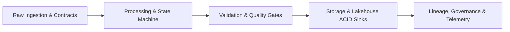
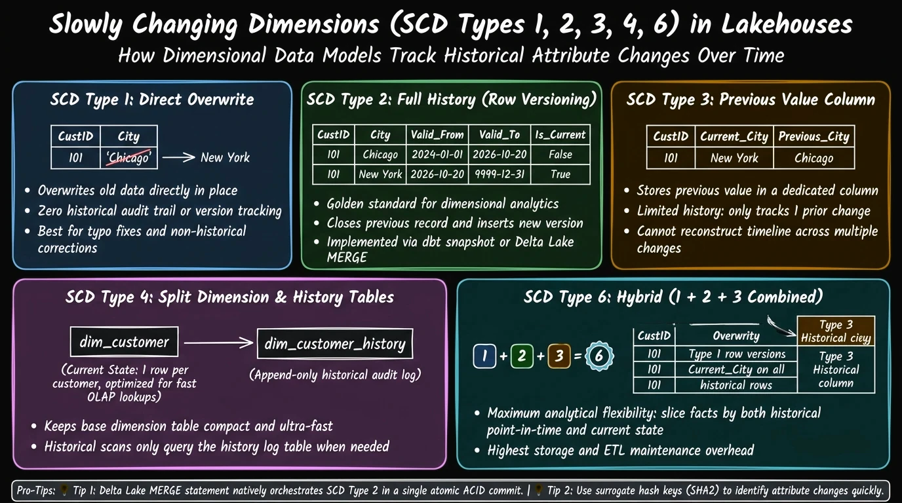

# 🛠️ The dbt & Analytics Engineering Handbook

**Enterprise Reference Architecture, Production Incident Runbooks & 4-Tier Interview Preparation Matrix**

[](https://github.com/santoshjammi29/dbt-handbook/actions)
[](#)
[](LICENSE)

> Production dbt Core & dbt Cloud modeling, Jinja macros, incremental strategies, testing contracts, and dbt Mesh governance.  
> Part of the **Modern Data Engineering & Lakehouse Systems Encyclopedia** ecosystem anchored by [**moderndataengineer.uk**](https://moderndataengineer.uk).

[Platform Architecture](#️-platform-architecture) • [Whiteboard Blueprints](#-whiteboard-blueprints) • [Interactive CLI](#-interactive-cli-explorer) • [Architectures](#️-architectural-deep-dives) • [Runbooks](#-production-incident-runbooks) • [Interview Matrix](#-4-tier-interview-preparation-matrix)  • [Core Concepts (57 Topics)](#-core-curriculum-concepts--topics) • [Sister Repositories](#-ecosystem-interlinking--sister-repositories)

---

## 🧠 Core Curriculum Concepts & Topics (57 Topics Covered)

> 💡 **Enterprise Knowledge Base Integration**: This repository implements **57 production topics** from the [Modern Data Engineering Systems Encyclopedia (921 Topics)](https://moderndataengineer.uk/concepts), arranged in increasing order of difficulty.

### 📑 Topics Directory at a Glance

| Pillar / Module | Topic Count | Key Core Primitives Covered | Status |
|:---|:---:|:---|:---:|
| 🛠️ **dbt Core, Analytics Engineering & Semantic Modeling** | **57** | dbt Model, dbt Source, ref() Function, dbt Seed, and 53 more | ✅ Fully Documented |

<details>
<summary><b>🛠️ dbt Core, Analytics Engineering & Semantic Modeling (57 Topics)</b> — <i>Click to expand topic index (sorted by difficulty)</i></summary>

| # | Topic / Concept | Level | Architectural Definition & Core Principle |
|:---:|---|:---:|---|
| 1 | **dbt Model** | 🟢<br>Easy | A dbt model is a single SQL SELECT statement defined in a .sql file that compiles and materializes a table, view, or incremental dataset in the data warehouse. |
| 2 | **dbt run command** | 🟢<br>Easy | The dbt run command is the core CLI command that compiles and executes SQL models in the target warehouse according to the project's dependency DAG. |
| 3 | **dbt Seed** | 🟢<br>Easy | A dbt seed is a static CSV file placed in the seeds/ directory that dbt loads directly into the data warehouse as a version-controlled lookup table. |
| 4 | **dbt Source** | 🟢<br>Easy | A dbt source represents an external raw table loaded by an ingestion tool (e.g. Fivetran, Airbyte) that is registered in dbt using YAML configuration files. |
| 5 | **Ephemeral Materialization** | 🟢<br>Easy | Ephemeral materialization creates a reusable SQL code block that is not written to the database at all, but rather interpolated as a Common Table Expression (CTE) into downstream models. |
| 6 | **Generic Tests** | 🟢<br>Easy | Generic tests are parameterized, reusable schema validation tests defined in YAML that assert data quality constraints against columns or models. |
| 7 | **Incremental Materialization** | 🟢<br>Easy | Incremental materialization allows dbt to transform and insert only newly arrived or modified records since the previous pipeline run, rather than rebuilding the entire table. |
| 8 | **profiles.yml** | 🟢<br>Easy | The profiles.yml file stores warehouse connection configurations, authentication credentials, and environment target settings outside of the project code repository. |
| 9 | **ref() Function** | 🟢<br>Easy | The ref() function is dbt's core interpolation macro used to reference other models within a project, automatically building the Directed Acyclic Graph (DAG) of dependencies. |
| 10 | **schema.yml** | 🟢<br>Easy | A schema.yml file is a configuration file where models, columns, descriptions, tests, and documentation metadata are declaratively registered in dbt. |
| 11 | **Table Materialization** | 🟢<br>Easy | Table materialization rebuilds the target model as a physical relational table in the data warehouse on every dbt run using CREATE TABLE AS SELECT (CTAS) logic. |
| 12 | **View Materialization** | 🟢<br>Easy | View materialization defines the model as a virtual database view using CREATE VIEW AS SELECT, storing only the SQL query definition without persisting physical data. |
| 13 | **Analyses** | 🟡<br>Intermediate | Analyses are one-off SQL queries stored in the analyses/ directory that utilize dbt Jinja and ref() functions but are compiled without being materialized in the database. |
| 14 | **Custom Schema Override** | 🟡<br>Intermediate | Custom Schema Override is the pattern of overriding dbt's default `generate_schema_name` macro to control how schema names are generated across dev and prod environments. |
| 15 | **Data Trust Service-Level Objective** | 🟡<br>Intermediate | A measurable commitment that a data product meets agreed freshness, quality, lineage, and ownership expectations for its consumers. |
| 16 | **dbt build Command** | 🟡<br>Intermediate | The dbt build command executes models, runs tests, creates snapshots, and loads seeds in a unified DAG sequence, halting downstream nodes if an upstream model or test fails. |
| 17 | **dbt Macros** | 🟡<br>Intermediate | dbt Macros are reusable, parameterizable Jinja code blocks defined in the macros/ directory that compile into dynamic SQL during project execution. |
| 18 | **dbt Semantic Layer** | 🟡<br>Intermediate | The dbt Semantic Layer (powered by MetricFlow) allows organizations to centrally define metrics and dimensions on top of dbt models, providing consistent metric calculation across all BI tools. |
| 19 | **dbt Slim CI & State:Modified Execution** | 🟡<br>Intermediate | A CI/CD optimization technique that compares the current Git branch against production manifest artifacts, running and testing only models modified in the pull request. |
| 20 | **dbt Snapshot (SCD Type 2)** | 🟡<br>Intermediate | A dbt snapshot captures and records changes to mutable source data over time, automatically maintaining a Slowly Changing Dimension (SCD Type 2) history table. |
| 21 | **dbt Snapshot Timestamp vs. Check Strategy** | 🟡<br>Intermediate | Slowly Changing Dimension Type 2 implementation strategies comparing updated timestamps versus hashing column values. |
| 22 | **dbt-utils Package** | 🟡<br>Intermediate | dbt-utils is the foundational open-source macro package maintained by dbt Labs that provides essential utility macros, cross-database SQL helpers, and advanced schema tests. |
| 23 | **Exposures** | 🟡<br>Intermediate | Exposures are YAML declarations in dbt that document downstream consumers of dbt models, such as dashboards, ML models, and operational APIs. |
| 24 | **Incremental Models (unique_key)** | 🟡<br>Intermediate | The unique_key configuration in incremental models specifies the primary key column(s) used by dbt to update existing records and insert new records during MERGE operations. |
| 25 | **Jinja Templating in dbt** | 🟡<br>Intermediate | Jinja is the Python-based templating engine embedded within dbt that compiles dynamic SQL, enables control flow loops and conditionals, and evaluates environment parameters. |
| 26 | **Pre/Post Hooks** | 🟡<br>Intermediate | Pre-hooks and post-hooks are SQL statements or macros executed immediately before or after a dbt model is materialized in the database. |
| 27 | **Singular Tests** | 🟡<br>Intermediate | A singular test is a standalone SQL query stored in the tests/ directory that defines a custom business assertion that fails if the query returns any rows. |
| 28 | **--defer Flag** | 🔴<br>Advanced | The --defer flag allows dbt to resolve unbuilt upstream dependencies in a developer sandbox by pointing to production models recorded in a production manifest.json artifact. |
| 29 | **Adapter-Specific Macros** | 🔴<br>Advanced | Adapter-Specific Macros use dbt's multiple-dispatch mechanism to execute different SQL implementations depending on the target database engine (Snowflake, BigQuery, Databricks). |
| 30 | **Cross-Database Macros** | 🔴<br>Advanced | Cross-Database Macros provide standardized SQL syntax for functions that vary across database dialects, allowing dbt projects to run on any cloud warehouse platform. |
| 31 | **Custom Materializations** | 🔴<br>Advanced | Custom Materializations are user-defined dbt materialization macros that control the exact DDL, staging steps, and transaction mechanics used to persist models in the warehouse. |
| 32 | **Data Product Contract and Service Objectives** | 🔴<br>Advanced | A consumer-facing agreement that describes a data product's schema, semantics, quality checks, freshness, availability, ownership, and change policy. |
| 33 | **dbt Compile vs Run vs Build** | 🔴<br>Advanced | The core architectural distinction between dbt compile (generating warehouse SQL), dbt run (executing model DDL/DML), and dbt build (unified execution of seeds, models, tests, and snapshots). |
| 34 | **dbt Incremental Microbatch Strategy** | 🔴<br>Advanced | A partition-aware incremental loading strategy dividing large table updates into discrete time-based batches. |
| 35 | **dbt Model Contracts** | 🔴<br>Advanced | Explicit schema constraints enforced by dbt at build time, guaranteeing column names, data types, and nullability. |
| 36 | **dbt Slim CI with Deferred State Modification** | 🔴<br>Advanced | A CI/CD optimization pattern in dbt that runs and tests only newly modified or upstream/downstream impacted models by comparing git branch artifacts against production manifests. |
| 37 | **dbt-audit-helper** | 🔴<br>Advanced | dbt-audit-helper is a dbt package that provides macros to compare row-by-row data parity between two relations, verifying refactored models against legacy tables. |
| 38 | **Graph Selection Syntax** | 🔴<br>Advanced | Graph Selection Syntax is dbt's powerful query language used in CLI arguments (--select, --exclude) to selectively execute targeted subgraphs of models, tests, and sources. |
| 39 | **Manifest.json Internals** | 🔴<br>Advanced | The manifest.json file is a comprehensive JSON artifact generated during compilation that contains the full semantic model, dependency graph, and metadata of the entire dbt project. |
| 40 | **Partial Parsing** | 🔴<br>Advanced | Partial Parsing is a performance optimization engine in dbt Core that caches previously parsed project files in manifest.json, reparsing only modified files on subsequent runs. |
| 41 | **Semantic Metric Verification for AI-Generated SQL** | 🔴<br>Advanced | An automated validation layer that intercepts AI-generated analytical SQL and verifies its table joins, filter predicates, and metric grains against governed semantic contracts before execution. |
| 42 | **Source Freshness Checks** | 🔴<br>Advanced | Source Freshness Checks are automated SLA validations executed via dbt source freshness that assert whether raw source tables have received recent data updates. |
| 43 | **State-Based CI** | 🔴<br>Advanced | State-Based CI (Slim CI) is a continuous integration testing strategy that compares pull request code against a production manifest to test strictly modified models and their first-order dependents. |
| 44 | **Cost Governance with dbt** | 🟣<br>Architect | Cost Governance in dbt involves implementing architectural practices, query tagging, incremental models, and compute warehouse sizing to optimize cloud data warehouse expenditures. |
| 45 | **dbt + Airflow Orchestration** | 🟣<br>Architect | The enterprise integration pattern combining Apache Airflow as the global workflow orchestrator with dbt as the specialized in-warehouse transformation engine. |
| 46 | **dbt + Databricks Integration** | 🟣<br>Architect | The architectural design pairing dbt with Databricks, utilizing dbt-databricks adapters against Databricks SQL Serverless Warehouses and Unity Catalog. |
| 47 | **dbt Core vs dbt Cloud** | 🟣<br>Architect | The strategic architectural evaluation between hosting open-source dbt-core via custom orchestrators versus adopting the managed enterprise SaaS platform, dbt Cloud. |
| 48 | **dbt Mesh & Cross-Project Dependencies** | 🟣<br>Architect | An enterprise multi-project architecture in dbt that enables decentralized teams to maintain independent dbt repositories while referencing public models across project boundaries. |
| 49 | **dbt Mesh (Cross-Project Refs)** | 🟣<br>Architect | dbt Mesh is an enterprise data architecture that decomposes monolithic dbt repositories into multiple autonomous, domain-owned projects connected via cross-project ref() calls. |
| 50 | **dbt Production Deployment** | 🟣<br>Architect | The production deployment architecture for dbt encompassing containerization, blue/green environment promotion, automated rollback strategies, and observability integration. |
| 51 | **dbt Semantic Layer & MetricFlow** | 🟣<br>Architect | A unified semantic specification defining business metrics (e.g. Net Revenue, Customer Churn) centrally in dbt. |
| 52 | **dbt Semantic Layer at Scale** | 🟣<br>Architect | The enterprise deployment architecture for the dbt Semantic Layer, serving unified metric definitions to thousands of concurrent BI, dashboard, and AI consumption consumers. |
| 53 | **dbt Testing Pyramid** | 🟣<br>Architect | The dbt Testing Pyramid is a quality architecture framework that structures data testing across unit tests, generic schema assertions, singular business assertions, and data observability. |
| 54 | **Monorepo vs Multi-Project dbt** | 🟣<br>Architect | The architectural trade-off between consolidating all corporate data transformations in a single Git monorepo versus establishing decentralized, domain-specific multi-project dbt repositories. |
| 55 | **Open Data Contract Specification (ODCS)** | 🟣<br>Architect | A standardized, vendor-neutral schema and metadata contract format that explicitly defines schema, semantics, SLA targets, and access permissions between data producers and consumers. |
| 56 | **Semantic Context Contract for Data Agents** | 🟣<br>Architect | A versioned definition of business terms, metrics, entities, and permitted joins that an AI system can use when answering data questions. |
| 57 | **Slim CI for dbt** | 🟣<br>Architect | Slim CI is an automated pull request verification pattern that uses state comparison artifacts to test exclusively modified models and their downstream dependencies in temporary sandboxes. |

</details>

---

## 🎯 Overview & Mission

Modern enterprise data systems require rigorous operational governance, predictable failure recovery, deterministic schemas, and observable pipeline execution.

This repository provides **battle-tested production specifications**:
- **4 Deep-Dive Architectural Blueprints**: In-depth engine mechanics, state stores, and Mermaid diagrams.
- **6 Production Incident Disaster Recovery Runbooks**: SEV-1 and SEV-2 playbooks with Emergency Decision Trees.
- **4-Tier Progressive Interview Matrix & 50 Flashcards**: Level 100 to Level 400 questions and active recall deck.
- **52 Whiteboard Blueprints**: Architectural infographics mirrored under `assets/whiteboards/`.
- **Interactive Terminal Shell**: Instant search and study directly from the terminal via `python scripts/interactive_shell.py`.

---

## 🏛️ Platform Architecture



---

## 🖼️ Master Whiteboard Architecture Blueprints

The repository includes **52 publication-grade architectural whiteboard blueprints** mirrored under [`assets/whiteboards/`](assets/whiteboards) and cataloged with comprehensive multi-persona breakdowns, failure modes, and engine internals in [`docs/whiteboard_diagrams/README.md`](docs/whiteboard_diagrams/README.md).

### 📐 Visual Blueprints Showcase

<table>
  <tr>
    <td width="50%" valign="top">
      <a href="docs/whiteboard_diagrams/README.md#dbt-analytics-engineering-dag">
        
      </a>
      <br><strong>dbt Modern Analytics Engineering DAG</strong><br>
      <em>Topological compilation, staging/intermediate/marts layering, and model dependency graph.</em>
    </td>
    <td width="50%" valign="top">
      <a href="docs/whiteboard_diagrams/README.md#data-quality-wap-quarantine">
        
      </a>
      <br><strong>Data Quality Observability & Write-Audit-Publish (WAP) Circuit Breaker Flow</strong><br>
      <em>Automated testing circuit breakers, quarantine schemas, and zero-defect production promotion.</em>
    </td>
  </tr>
  <tr>
    <td width="50%" valign="top">
      <a href="docs/whiteboard_diagrams/README.md#scd-types-lakehouse">
        
      </a>
      <br><strong>Slowly Changing Dimensions (SCD Types 1, 2, 3, 4, 6) in Modern Lakehouses</strong><br>
      <em>Snapshots, check vs timestamp strategy, and historical change tracking in lakehouses.</em>
    </td>
    <td width="50%" valign="top">
      <a href="docs/whiteboard_diagrams/README.md#data-mesh-enterprise-architecture">
        
      </a>
      <br><strong>Enterprise Data Mesh: Decentralized Domains & Data Products</strong><br>
      <em>Decentralized domain ownership, dbt Mesh cross-project refs, and formal data contracts.</em>
    </td>
  </tr>
  <tr>
    <td width="50%" valign="top">
      <a href="docs/whiteboard_diagrams/README.md#kimball-dimensional-star-schema">
        
      </a>
      <br><strong>Kimball Dimensional Modeling & Enterprise Star Schema</strong><br>
      <em>Conformed dimensions, additive facts, surrogate keys, and analytical reporting models.</em>
    </td>
    <td width="50%" valign="top">
      <a href="docs/whiteboard_diagrams/README.md#data-vault-enterprise-architecture">
        
      </a>
      <br><strong>Data Vault 2.0 Architecture & Lakehouse Modeling</strong><br>
      <em>Hubs, Links, Satellites, hash keys, and agile enterprise data integration.</em>
    </td>
  </tr>
  <tr>
    <td width="50%" valign="top">
      <a href="docs/whiteboard_diagrams/README.md#lakehouse-cicd-promotion-lifecycle">
        
      </a>
      <br><strong>Enterprise Lakehouse CI/CD Multi-Environment Promotion Flow</strong><br>
      <em>Slim CI (`state:modified+`), automated testing, and blue-green schema deployment.</em>
    </td>
    <td width="50%" valign="top">
      <a href="docs/whiteboard_diagrams/README.md#table-maintenance-compaction-vacuum">
        
      </a>
      <br><strong>Open Table Maintenance Lifecycle: Bin-Packing, Liquid Clustering & Safe VACUUM</strong><br>
      <em>Small file compaction, multidimensional clustering, and storage hygiene.</em>
    </td>
  </tr>
</table>

> 🔍 **Explore all 52 blueprints with 5-persona breakdowns, failure modes, and engine internals in [docs/whiteboard_diagrams/README.md](docs/whiteboard_diagrams/README.md)**.

## 💻 Interactive CLI Explorer

Explore architectures, runbooks, and interview guides directly from your terminal:

```bash
# Browse catalog
python scripts/interactive_shell.py --list
python scripts/interactive_shell.py --runbooks
python scripts/interactive_shell.py --architectures
python scripts/interactive_shell.py --interview
python scripts/interactive_shell.py --ecosystem

# Run self-contained test suite
python scripts/run_tests.py
```

---

## 📦 Production Curriculum Modules

| Module | Title & Focus | Key Deliverables & Code |
| :---: | :--- | :--- |
| **01** | **[Project Architecture & Source Freshness](modules/01_project_structure_and_sources/README.md)** | Directory conventions, `_sources.yml`, freshness SLAs (`warn_after`, `error_after`), `stg_ecommerce__orders.sql` |
| **02** | **[Materializations & Persistence](modules/02_materializations_and_persistence/README.md)** | Views, tables, ephemeral CTEs, materialized views, `dim_customers.sql` |
| **03** | **[Incremental Strategies & Microbatch](modules/03_incremental_strategies_and_microbatch/README.md)** | `merge`, `delete+insert`, `append`, `insert_overwrite`, 3-day lookback buffers, `fct_web_events_incremental.sql` |
| **04** | **[Jinja2 Macros & Adapter Dispatch](modules/04_jinja_macros_and_adapter_dispatch/README.md)** | Cross-database `adapter.dispatch()`, MD5 surrogate keys, post-hook security grants |
| **05** | **[Snapshots & SCD Type 2](modules/05_snapshots_and_scd_type_2/README.md)** | Timestamp vs check strategy, collision handling, `snap_subscription_plans.sql` |
| **06** | **[Data Contracts & Model Constraints](modules/06_data_contracts_and_model_constraints/README.md)** | Enforceable schemas (`contract: {enforced: true}`), primary key & check constraints, `orders_contracted.sql` |
| **07** | **[Testing Pyramid & Native Unit Tests](modules/07_testing_auditing_and_unit_tests/README.md)** | Generic schema tests, singular SQL assertion queries, mock YAML fixtures (dbt 1.8+) |
| **08** | **[dbt Mesh & Multi-Project Governance](modules/08_dbt_mesh_and_cross_project_governance/README.md)** | Decoupled domain nodes, `public` models, cross-project `ref()`, producer/consumer boundaries |
| **09** | **[Semantic Layer & MetricFlow](modules/09_semantic_layer_and_metricflow/README.md)** | Semantic models, entities, dimensions, cumulative and ratio metrics |
| **10** | **[Production CI/CD & Slim CI](modules/10_cicd_slim_ci_and_orchestration/README.md)** | GitHub Actions workflow, state deferral (`--defer --state`), 85% compute savings |

---

## 🏛️ Architectural Deep Dives

Four production-tested architectural specifications located under `architectures/`:

| Spec ID | Document Title | Target Level | Core Architectural Focus |
| :---: | :--- | :---: | :--- |
| **01** | **[dbt Compilation & Directed Acyclic Graph (DAG) Generation](architectures/01_dbt_compiler_and_dag_generation.md)** | `Level 300-400` | Explains the manifest.json generation, ref() dependency resolution, and runtime topological sort. |
| **02** | **[Incremental Materialization Mechanics](architectures/02_incremental_strategies_and_merge_internals.md)** | `Level 300-400` | Under-the-hood comparison of merge, delete+insert, and insert_overwrite across cloud engines. |
| **03** | **[dbt Mesh & Multi-Project Governance](architectures/03_dbt_mesh_and_cross_project_governance.md)** | `Level 300-400` | Contract enforcement, model access (public/private), and decoupled data mesh domains. |
| **04** | **[Semantic Layer & MetricFlow Architecture](architectures/04_semantic_layer_and_metricflow_architecture.md)** | `Level 300-400` | Semantic models, dimensions, entities, and consistent query generation. |

---

## 🚨 Production Incident Runbooks

Six operational disaster recovery runbooks located under `runbooks/`:

| Runbook ID | Title & Direct Link | Severity | Root Cause & Remediation Focus |
| :---: | :--- | :---: | :--- |
| **01** | **[Incremental Schema Drift & Merge Failure Triage](runbooks/01_incremental_schema_drift_and_merge_failures.md)** | `SEV-1` | Triage unannounced upstream column additions, type mismatches, and merge conflicts. |
| **02** | **[Snapshot SCD2 Timestamp Collision & Timeline Corruption](runbooks/02_snapshot_scd2_timestamp_collision_triage.md)** | `SEV-1` | Detect overlapping validity intervals and duplicate active rows in snapshots. |
| **03** | **[Circular Dependency & DAG Compilation Deadlocks](runbooks/03_circular_dependency_and_dag_deadlock_triage.md)** | `SEV-2` | Isolate cycle loops created across models, seeds, and source references. |
| **04** | **[Runaway Warehouse Spend on Full Refresh Runs](runbooks/04_warehouse_credit_exhaustion_from_full_refresh.md)** | `SEV-2` | Prevent unconstrained full refreshes on multi-terabyte tables without partition bounds. |
| **05** | **[Data Contract Violation & Breaking Change Quarantine](runbooks/05_data_contract_breaking_change_quarantine.md)** | `SEV-1` | Handle schema contract rejections, null constraint errors, and consumer breaking changes. |
| **06** | **[Slim CI State Deferral & Artifact Sync Failures](runbooks/06_slim_ci_state_deferred_deferral_failures.md)** | `SEV-2` | Diagnose stale manifest.json downloads and state-deferred build mismatches in CI. |

---

## 🎓 4-Tier Interview Preparation Matrix

Comprehensive technical interview guides and flashcard deck located under `interview/`:

| Tier | Role Target | Core Focus Areas | Direct Link |
| :---: | :--- | :--- | :---: |
| **Tier 1** | **Junior Analytics Engineer** | SQL transformations, staging models, source freshness, basic tests, packages. | [`01_junior.md`](interview/01_junior_analytics_engineer.md) |
| **Tier 2** | **Mid-Level Analytics Engineer** | Incremental models, custom Jinja macros, snapshots (SCD2), seeds, documentation. | [`02_mid_level.md`](interview/02_mid_level_analytics_engineer.md) |
| **Tier 3** | **Senior Analytics Engineer** | Query plan tuning, dbt-expectations, custom generic tests, warehouse optimizations. | [`03_senior.md`](interview/03_senior_analytics_engineer.md) |
| **Tier 4** | **Staff & Principal Data Architect** | dbt Mesh, model contracts, semantic layer architecture, enterprise Slim CI/CD. | [`04_staff.md`](interview/04_staff_principal_data_architect.md) |
| **Deck** | **50 Rapid-Fire Flashcards** | 50 active recall questions and answers for technical mastery. | [`05_flashcards.md`](interview/05_flashcards_deck_50.md) |

---

## 🌐 Ecosystem Interlinking & Sister Repositories

The Modern Data Engineering Lakehouse Ecosystem is an integrated suite of 13 production-grade, specialized repositories anchored by the **[Modern Data Engineer Platform ()](https://github.com/santoshjammi29/moderndataengineer)**. Use this cross-reference matrix to navigate directly between complementary implementations across our repositories:

| Repository | Focus & Domain | Tightly Coupled Cross-Reference & Integration Points |
| :--- | :--- | :--- |
| **[DataOps & CI/CD Handbook](https://github.com/santoshjammi29/dataops-cicd-handbook)** | Platform Engineering & GitOps | • **dbt Slim CI & State Deferral**: Reusable GitHub Actions workflows running state:modified+ PR runs against isolated schemas.<br>• **Write-Audit-Publish (WAP)**: Circuit breakers preventing unverified dbt model outputs from reaching production. |
| **[The SQL Handbook](https://github.com/santoshjammi29/sql-handbook)** | Relational Query Engines, MPP & Concurrency | • **SQL Transformation Mastery**: Window functions, query plan tuning, and Jinja macros powering complex dbt models.<br>• **Incremental Merge Logic**: Partition-aligned merge strategies eliminating full table scans. |
| **[The Databricks Handbook](https://github.com/santoshjammi29/databricks-handbook)** | 105 Databricks Production Recipes & Unity Catalog | • **dbt-databricks Adapter**: Materializing Lakehouse Bronze/Silver/Gold tables via dbt models with Unity Catalog contracts.<br>• **Liquid Clustering**: Space-filling curve table layout replacing traditional partitioning in dbt models. |
| **[The PySpark Handbook](https://github.com/santoshjammi29/pyspark-handbook)** | Apache Spark 3.5+, Catalyst & Arrow UDFs | • **Python dbt Models**: Implementing complex data science transformations and PyArrow UDFs inside dbt projects.<br>• **Catalyst AST Optimization**: Tuning SQL generated by dbt to avoid Cartesian joins and spill. |
| **[Azure Databricks Blueprints](https://github.com/santoshjammi29/azure-databricks-project-blueprints)** | 3 Enterprise Reference Architectures | • **Dimensional Modeling (SCD Type 2)**: Companion dbt snapshot and incremental merge models for retail customer dimensions.<br>• **Data Contracts**: Schema enforcement between source systems and lakehouse tables. |
| **[Banking Risk Lakehouse](https://github.com/santoshjammi29/enterprise-banking-risk-alm-lakehouse)** | Regulated Financial Lakehouse (BCBS 239 & IFRS 9) | • **Financial Staging Models**: Modular staging, intermediate, and marts layering with strict data contracts for risk indicators.<br>• **Audit Reconciliations**: Automated dbt test assertions validating balance sheet reconciliation. |
| **[Streaming Handbook](https://github.com/santoshjammi29/streaming-handbook)** | Kafka KRaft, Apache Flink & Event Architecture | • **Microbatch Streaming Ingestion**: dbt incremental models consuming from real-time Kafka landing tables.<br>• **Change Data Capture**: Modeling Debezium CDC change streams into conformed analytical dimensions. |
| **[Spark Experiments](https://github.com/santoshjammi29/spark-experiments)** | Empirical Skew, Salting & Spill Laboratory | • **dbt Performance on Spark**: Optimizing incremental dbt models running on Apache Spark and Databricks SQL.<br>• **Partition Pruning**: Aligning dbt models with Spark partition schemes to eliminate full table scans. |
| **[System Design Handbook](https://github.com/santoshjammi29/data-system-design-handbook)** | Distributed Storage, Table Formats & BCDR | • **Data Mesh & Contracts**: Designing decentralized domain data products with version-controlled contracts.<br>• **Table Formats**: Delta Lake vs Apache Iceberg transactional guarantees underlying dbt models. |
| **[Azure Cheat Sheet](https://github.com/santoshjammi29/azure-cheat-sheet)** | Fabric OneLake, Synapse & Azure Infrastructure | • **dbt on Azure**: Deploying dbt models against Azure Synapse and Microsoft Fabric Data Warehouses.<br>• **Power BI Semantic Layer**: Connecting dbt MetricFlow semantic metrics to Power BI semantic models. |
| **[Interview Handbook](https://github.com/santoshjammi29/data-engineering-interview-handbook)** | Architectural Defense Playbooks & Concepts | • **Pillar 07 Defense**: dbt Mesh cross-project dependencies, Microbatch incremental strategy, and contracts.<br>• **Pillar 20 WAP Pattern**: Implementing Write-Audit-Publish circuit breakers in dbt. |
| **[Modern Data Engineer Hub](https://github.com/santoshjammi29/moderndataengineer)** | Central Edge Presentation Platform | • **Interactive Whiteboard Viewer**: Pan, zoom, and inspect all 52 blueprints at [moderndataengineer.uk/whiteboards](https://moderndataengineer.uk/whiteboards).<br>• **Concept Encyclopedia**: 921 verified topics across analytics engineering and data architecture. |

## 📜 License

Distributed under the **[MIT License](LICENSE)**. Maintained with ❤️ by [Santosh Jammi](https://github.com/santoshjammi29) (2026).
