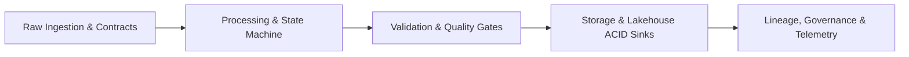
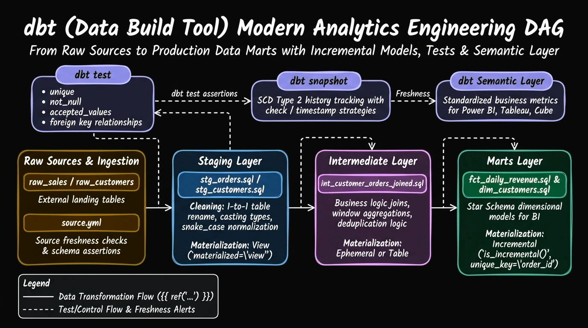
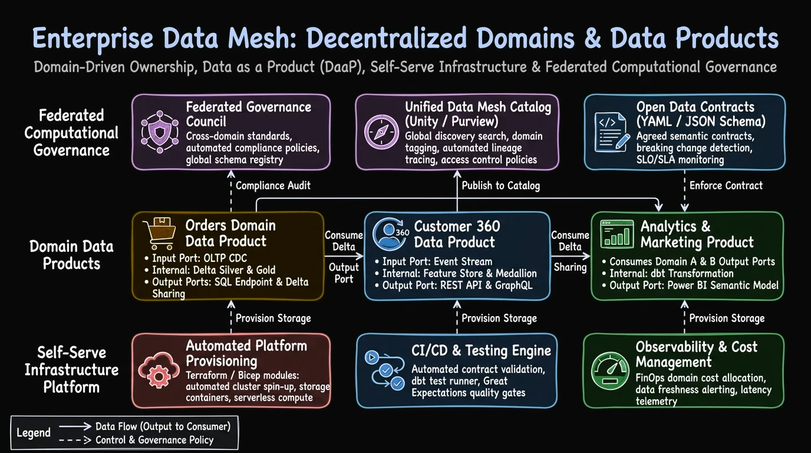
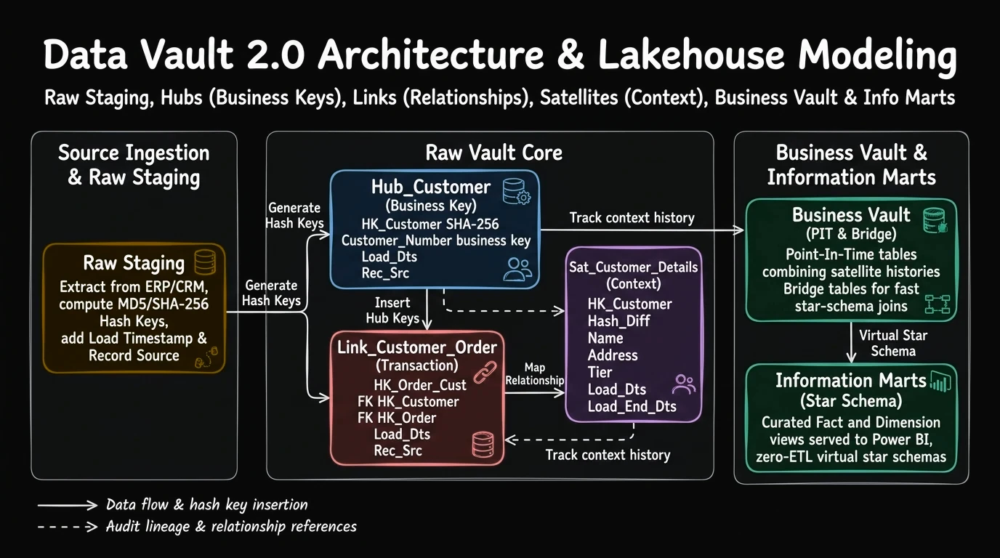
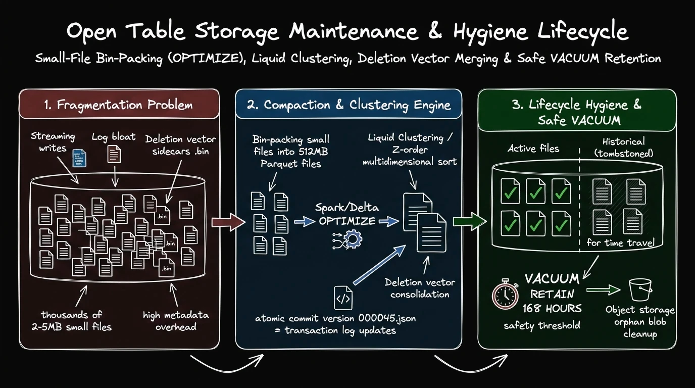

# 🛠️ The dbt & Analytics Engineering Handbook

**Enterprise Reference Architecture, Production Incident Runbooks & 4-Tier Interview Preparation Matrix**

[](https://github.com/santoshjammi29/dbt-handbook/actions)
[](#)
[](LICENSE)

> Production dbt Core & dbt Cloud modeling, Jinja macros, incremental strategies, testing contracts, and dbt Mesh governance.  
> Part of the **Modern Data Engineering & Lakehouse Systems Encyclopedia** ecosystem anchored by [**moderndataengineer.uk**](https://moderndataengineer.uk).

[Platform Architecture](#️-platform-architecture) • [Whiteboard Blueprints](#-whiteboard-blueprints) • [Interactive CLI](#-interactive-cli-explorer) • [Architectures](#️-architectural-deep-dives) • [Runbooks](#-production-incident-runbooks) • [Interview Matrix](#-4-tier-interview-preparation-matrix) • [Sister Repositories](#-ecosystem-interlinking--sister-repositories)

---

## 🎯 Overview & Mission

Modern enterprise data systems require rigorous operational governance, predictable failure recovery, deterministic schemas, and observable pipeline execution.

This repository provides **battle-tested production specifications**:
- **4 Deep-Dive Architectural Blueprints**: In-depth engine mechanics, state stores, and Mermaid diagrams.
- **6 Production Incident Disaster Recovery Runbooks**: SEV-1 and SEV-2 playbooks with Emergency Decision Trees.
- **4-Tier Progressive Interview Matrix & 50 Flashcards**: Level 100 to Level 400 questions and active recall deck.
- **52 Whiteboard Blueprints**: Architectural infographics mirrored under `assets/whiteboards/`.
- **Interactive Terminal Shell**: Instant search and study directly from the terminal via `python scripts/interactive_shell.py`.

---

## 🏛️ Platform Architecture



---

## 🖼️ Master Whiteboard Architecture Blueprints

The repository includes **52 publication-grade architectural whiteboard blueprints** mirrored under [`assets/whiteboards/`](assets/whiteboards) and cataloged with comprehensive multi-persona breakdowns, failure modes, and engine internals in [`docs/whiteboard_diagrams/README.md`](docs/whiteboard_diagrams/README.md).

### 📐 Visual Blueprints Showcase

<table>
  <tr>
    <td width="50%" valign="top">
      <a href="docs/whiteboard_diagrams/README.md#dbt-analytics-engineering-dag">
        
      </a>
      <br><strong>dbt Modern Analytics Engineering DAG</strong><br>
      <em>Topological compilation, staging/intermediate/marts layering, and model dependency graph.</em>
    </td>
    <td width="50%" valign="top">
      <a href="docs/whiteboard_diagrams/README.md#data-quality-wap-quarantine">
        
      </a>
      <br><strong>Data Quality Observability & Write-Audit-Publish (WAP) Circuit Breaker Flow</strong><br>
      <em>Automated testing circuit breakers, quarantine schemas, and zero-defect production promotion.</em>
    </td>
  </tr>
  <tr>
    <td width="50%" valign="top">
      <a href="docs/whiteboard_diagrams/README.md#scd-types-lakehouse">
        
      </a>
      <br><strong>Slowly Changing Dimensions (SCD Types 1, 2, 3, 4, 6) in Modern Lakehouses</strong><br>
      <em>Snapshots, check vs timestamp strategy, and historical change tracking in lakehouses.</em>
    </td>
    <td width="50%" valign="top">
      <a href="docs/whiteboard_diagrams/README.md#data-mesh-enterprise-architecture">
        
      </a>
      <br><strong>Enterprise Data Mesh: Decentralized Domains & Data Products</strong><br>
      <em>Decentralized domain ownership, dbt Mesh cross-project refs, and formal data contracts.</em>
    </td>
  </tr>
  <tr>
    <td width="50%" valign="top">
      <a href="docs/whiteboard_diagrams/README.md#kimball-dimensional-star-schema">
        
      </a>
      <br><strong>Kimball Dimensional Modeling & Enterprise Star Schema</strong><br>
      <em>Conformed dimensions, additive facts, surrogate keys, and analytical reporting models.</em>
    </td>
    <td width="50%" valign="top">
      <a href="docs/whiteboard_diagrams/README.md#data-vault-enterprise-architecture">
        
      </a>
      <br><strong>Data Vault 2.0 Architecture & Lakehouse Modeling</strong><br>
      <em>Hubs, Links, Satellites, hash keys, and agile enterprise data integration.</em>
    </td>
  </tr>
  <tr>
    <td width="50%" valign="top">
      <a href="docs/whiteboard_diagrams/README.md#lakehouse-cicd-promotion-lifecycle">
        
      </a>
      <br><strong>Enterprise Lakehouse CI/CD Multi-Environment Promotion Flow</strong><br>
      <em>Slim CI (`state:modified+`), automated testing, and blue-green schema deployment.</em>
    </td>
    <td width="50%" valign="top">
      <a href="docs/whiteboard_diagrams/README.md#table-maintenance-compaction-vacuum">
        
      </a>
      <br><strong>Open Table Maintenance Lifecycle: Bin-Packing, Liquid Clustering & Safe VACUUM</strong><br>
      <em>Small file compaction, multidimensional clustering, and storage hygiene.</em>
    </td>
  </tr>
</table>

> 🔍 **Explore all 52 blueprints with 5-persona breakdowns, failure modes, and engine internals in [docs/whiteboard_diagrams/README.md](docs/whiteboard_diagrams/README.md)**.

## 💻 Interactive CLI Explorer

Explore architectures, runbooks, and interview guides directly from your terminal:

```bash
# Browse catalog
python scripts/interactive_shell.py --list
python scripts/interactive_shell.py --runbooks
python scripts/interactive_shell.py --architectures
python scripts/interactive_shell.py --interview
python scripts/interactive_shell.py --ecosystem

# Run self-contained test suite
python scripts/run_tests.py
```

---

## 📦 Production Curriculum Modules

| Module | Title & Focus | Key Deliverables & Code |
| :---: | :--- | :--- |
| **01** | **[Project Architecture & Source Freshness](modules/01_project_structure_and_sources/README.md)** | Directory conventions, `_sources.yml`, freshness SLAs (`warn_after`, `error_after`), `stg_ecommerce__orders.sql` |
| **02** | **[Materializations & Persistence](modules/02_materializations_and_persistence/README.md)** | Views, tables, ephemeral CTEs, materialized views, `dim_customers.sql` |
| **03** | **[Incremental Strategies & Microbatch](modules/03_incremental_strategies_and_microbatch/README.md)** | `merge`, `delete+insert`, `append`, `insert_overwrite`, 3-day lookback buffers, `fct_web_events_incremental.sql` |
| **04** | **[Jinja2 Macros & Adapter Dispatch](modules/04_jinja_macros_and_adapter_dispatch/README.md)** | Cross-database `adapter.dispatch()`, MD5 surrogate keys, post-hook security grants |
| **05** | **[Snapshots & SCD Type 2](modules/05_snapshots_and_scd_type_2/README.md)** | Timestamp vs check strategy, collision handling, `snap_subscription_plans.sql` |
| **06** | **[Data Contracts & Model Constraints](modules/06_data_contracts_and_model_constraints/README.md)** | Enforceable schemas (`contract: {enforced: true}`), primary key & check constraints, `orders_contracted.sql` |
| **07** | **[Testing Pyramid & Native Unit Tests](modules/07_testing_auditing_and_unit_tests/README.md)** | Generic schema tests, singular SQL assertion queries, mock YAML fixtures (dbt 1.8+) |
| **08** | **[dbt Mesh & Multi-Project Governance](modules/08_dbt_mesh_and_cross_project_governance/README.md)** | Decoupled domain nodes, `public` models, cross-project `ref()`, producer/consumer boundaries |
| **09** | **[Semantic Layer & MetricFlow](modules/09_semantic_layer_and_metricflow/README.md)** | Semantic models, entities, dimensions, cumulative and ratio metrics |
| **10** | **[Production CI/CD & Slim CI](modules/10_cicd_slim_ci_and_orchestration/README.md)** | GitHub Actions workflow, state deferral (`--defer --state`), 85% compute savings |

---

## 🏛️ Architectural Deep Dives

Four production-tested architectural specifications located under `architectures/`:

| Spec ID | Document Title | Target Level | Core Architectural Focus |
| :---: | :--- | :---: | :--- |
| **01** | **[dbt Compilation & Directed Acyclic Graph (DAG) Generation](architectures/01_dbt_compiler_and_dag_generation.md)** | `Level 300-400` | Explains the manifest.json generation, ref() dependency resolution, and runtime topological sort. |
| **02** | **[Incremental Materialization Mechanics](architectures/02_incremental_strategies_and_merge_internals.md)** | `Level 300-400` | Under-the-hood comparison of merge, delete+insert, and insert_overwrite across cloud engines. |
| **03** | **[dbt Mesh & Multi-Project Governance](architectures/03_dbt_mesh_and_cross_project_governance.md)** | `Level 300-400` | Contract enforcement, model access (public/private), and decoupled data mesh domains. |
| **04** | **[Semantic Layer & MetricFlow Architecture](architectures/04_semantic_layer_and_metricflow_architecture.md)** | `Level 300-400` | Semantic models, dimensions, entities, and consistent query generation. |

---

## 🚨 Production Incident Runbooks

Six operational disaster recovery runbooks located under `runbooks/`:

| Runbook ID | Title & Direct Link | Severity | Root Cause & Remediation Focus |
| :---: | :--- | :---: | :--- |
| **01** | **[Incremental Schema Drift & Merge Failure Triage](runbooks/01_incremental_schema_drift_and_merge_failures.md)** | `SEV-1` | Triage unannounced upstream column additions, type mismatches, and merge conflicts. |
| **02** | **[Snapshot SCD2 Timestamp Collision & Timeline Corruption](runbooks/02_snapshot_scd2_timestamp_collision_triage.md)** | `SEV-1` | Detect overlapping validity intervals and duplicate active rows in snapshots. |
| **03** | **[Circular Dependency & DAG Compilation Deadlocks](runbooks/03_circular_dependency_and_dag_deadlock_triage.md)** | `SEV-2` | Isolate cycle loops created across models, seeds, and source references. |
| **04** | **[Runaway Warehouse Spend on Full Refresh Runs](runbooks/04_warehouse_credit_exhaustion_from_full_refresh.md)** | `SEV-2` | Prevent unconstrained full refreshes on multi-terabyte tables without partition bounds. |
| **05** | **[Data Contract Violation & Breaking Change Quarantine](runbooks/05_data_contract_breaking_change_quarantine.md)** | `SEV-1` | Handle schema contract rejections, null constraint errors, and consumer breaking changes. |
| **06** | **[Slim CI State Deferral & Artifact Sync Failures](runbooks/06_slim_ci_state_deferred_deferral_failures.md)** | `SEV-2` | Diagnose stale manifest.json downloads and state-deferred build mismatches in CI. |

---

## 🎓 4-Tier Interview Preparation Matrix

Comprehensive technical interview guides and flashcard deck located under `interview/`:

| Tier | Role Target | Core Focus Areas | Direct Link |
| :---: | :--- | :--- | :---: |
| **Tier 1** | **Junior Analytics Engineer** | SQL transformations, staging models, source freshness, basic tests, packages. | [`01_junior.md`](interview/01_junior_analytics_engineer.md) |
| **Tier 2** | **Mid-Level Analytics Engineer** | Incremental models, custom Jinja macros, snapshots (SCD2), seeds, documentation. | [`02_mid_level.md`](interview/02_mid_level_analytics_engineer.md) |
| **Tier 3** | **Senior Analytics Engineer** | Query plan tuning, dbt-expectations, custom generic tests, warehouse optimizations. | [`03_senior.md`](interview/03_senior_analytics_engineer.md) |
| **Tier 4** | **Staff & Principal Data Architect** | dbt Mesh, model contracts, semantic layer architecture, enterprise Slim CI/CD. | [`04_staff.md`](interview/04_staff_principal_data_architect.md) |
| **Deck** | **50 Rapid-Fire Flashcards** | 50 active recall questions and answers for technical mastery. | [`05_flashcards.md`](interview/05_flashcards_deck_50.md) |

---

## 🌐 Ecosystem Interlinking & Sister Repositories

The Modern Data Engineering ecosystem is intentionally partitioned into specialized, tightly coupled reference repositories anchored by **[Modern Data Engineer Platform (`moderndataengineer.uk`)](https://github.com/santoshjammi29/moderndataengineer)**:

| Core Engineering Focus | Flagship Repository | Direct Deep-Link Topics & Implementations in Sister Repositories |
| :--- | :--- | :--- |
| **Apache Spark & PySpark Core** | **[The PySpark Handbook](https://github.com/santoshjammi29/pyspark-handbook)** | • **Delta Lake ACID & Liquid Clustering**: [Databricks Handbook Mod 03 & 04](https://github.com/santoshjammi29/databricks-handbook)<br>• **SQL Windowing Equivalents**: [SQL Handbook Mod 04](https://github.com/santoshjammi29/sql-handbook)<br>• **Azure VNet Injection & Fabric Spark**: [Azure Cheat Sheet](https://github.com/santoshjammi29/azure-cheat-sheet) |
| **Databricks Platform** | **[The Databricks Handbook](https://github.com/santoshjammi29/databricks-handbook)** | • **Core PyArrow UDFs & Higher-Order Functions**: [PySpark Handbook Mod 01 & 02](https://github.com/santoshjammi29/pyspark-handbook)<br>• **Databricks SQL vs ANSI Rosetta Stone**: [SQL Handbook Runbook 05](https://github.com/santoshjammi29/sql-handbook)<br>• **Azure Databricks Landing Zones & Bicep IaC**: [Azure Cheat Sheet](https://github.com/santoshjammi29/azure-cheat-sheet) |
| **Relational & Cloud MPP SQL** | **[The SQL Handbook](https://github.com/santoshjammi29/sql-handbook)** | • **Distributed Data Movement & Skew Salting**: [PySpark Runbook 03](https://github.com/santoshjammi29/pyspark-handbook)<br>• **Serverless SQL Warehouse Spill Tuning**: [Databricks Runbook 05](https://github.com/santoshjammi29/databricks-handbook)<br>• **Synapse & Fabric OneLake Direct Lake SQL**: [Azure Architecture 01](https://github.com/santoshjammi29/azure-cheat-sheet) |
| **Enterprise Cloud & Fabric** | **[Azure Enterprise Handbook](https://github.com/santoshjammi29/azure-cheat-sheet)** | • **Databricks Asset Bundles (DABs) & Lakeflow**: [Databricks Handbook Mod 07](https://github.com/santoshjammi29/databricks-handbook)<br>• **Structured Streaming & RocksDB State**: [PySpark Handbook Mod 06](https://github.com/santoshjammi29/pyspark-handbook)<br>• **Cloud Warehouse Cost Hardening**: [SQL Handbook Runbook 06](https://github.com/santoshjammi29/sql-handbook) |
| **Analytics Engineering & dbt** | **[The dbt Handbook](https://github.com/santoshjammi29/dbt-handbook)** | • **Incremental Merge Optimizations**: [SQL Handbook Mod 06](https://github.com/santoshjammi29/sql-handbook)<br>• **dbt on Databricks & Unity Catalog**: [Databricks Handbook Mod 07](https://github.com/santoshjammi29/databricks-handbook)<br>• **Automated WAP Quality Gates**: [DataOps Handbook](https://github.com/santoshjammi29/dataops-cicd-handbook) |
| **Real-Time Streaming** | **[The Streaming Handbook](https://github.com/santoshjammi29/streaming-handbook)** | • **PySpark Structured Streaming & Watermarks**: [PySpark Handbook Mod 06](https://github.com/santoshjammi29/pyspark-handbook)<br>• **Event Hubs & IoT Real-Time Engine**: [Azure Architecture 04](https://github.com/santoshjammi29/azure-cheat-sheet)<br>• **Debezium CDC to Delta Lake**: [Databricks Handbook Mod 04](https://github.com/santoshjammi29/databricks-handbook) |
| **Data Systems Design** | **[Data System Design Handbook](https://github.com/santoshjammi29/data-system-design-handbook)** | • **MPP Distributed Engine Internals**: [SQL Handbook Architecture 02](https://github.com/santoshjammi29/sql-handbook)<br>• **Unified Memory & Catalyst Engine**: [PySpark Architecture 01 & 02](https://github.com/santoshjammi29/pyspark-handbook)<br>• **Zero-Trust Enterprise Landing Zones**: [Azure Architecture 02](https://github.com/santoshjammi29/azure-cheat-sheet) |
| **DataOps & Platform CI/CD** | **[DataOps & Platform Handbook](https://github.com/santoshjammi29/dataops-cicd-handbook)** | • **Databricks Asset Bundles (DABs) IaC**: [Databricks Handbook Mod 07](https://github.com/santoshjammi29/databricks-handbook)<br>• **Azure Bicep IaC & GitHub Actions OIDC**: [Azure Cheatsheet](https://github.com/santoshjammi29/azure-cheat-sheet)<br>• **dbt Slim CI & State Deferral**: [dbt Handbook](https://github.com/santoshjammi29/dbt-handbook) |
| **Unified Web Platform** | **[Modern Data Engineer Hub](https://github.com/santoshjammi29/moderndataengineer)** | • **Interactive Simulators & 52 Blueprints**: [Live Platform (`moderndataengineer.uk`)](https://moderndataengineer.uk)<br>• **Google-Grade BM25F Search & Virtual DOM**: [Architecture Spec](https://github.com/santoshjammi29/moderndataengineer/blob/main/docs/STANDARDIZED_ARCHITECTURE.md) |


---

## 📜 License

Distributed under the **[MIT License](LICENSE)**. Maintained with ❤️ by [Santosh Jammi](https://github.com/santoshjammi29) (2026).
