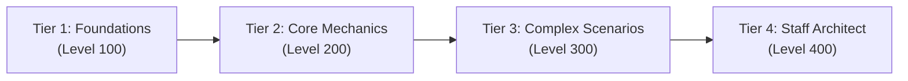

# 🗺️ dbt Handbook — Interactive Curriculum Roadmap

> **Interactive Checkbox Study Tracker & Mastery Progression**  
> **Canonical Repository**: [santoshjammi29/dbt-handbook](https://github.com/santoshjammi29/dbt-handbook) | **Ecosystem**: [moderndataengineer.uk](https://moderndataengineer.uk)  
> **Total Exercises & Drills**: `21` | **Primary Pillar**: `dbt & Analytics Engineering`

---

## How to Use This Roadmap

1. **Fork this repository** to your personal GitHub account.
2. Work through the modules in sequence or target specific architectural topics.
3. Check off boxes (`- [x]`) as you complete each exercise, drill, or notebook.
4. Commit and push your progress to your personal branch to track your career journey!

```
Progress: [ ] 0 / 21 Completed (0.0%)
```

---

## Curriculum Structure: The 4 Mastery Tiers



### 🟡 Tier 2: Core Mechanics & Implementation (Level 200)
> Production pipeline patterns, schema validation, standard transformations, and unit tests.

- [ ] `dbt-handbook-01_project_structure_and_sources` — [Project Structure And Sources](modules/01_project_structure_and_sources/README.md) `Level 200`
- [ ] `dbt-handbook-02_materializations_and_persistence` — [Materializations And Persistence](modules/02_materializations_and_persistence/README.md) `Level 200`
- [ ] `dbt-handbook-03_incremental_strategies_and_microbatch` — [Incremental Strategies And Microbatch](modules/03_incremental_strategies_and_microbatch/README.md) `Level 200`
- [ ] `dbt-handbook-04_jinja_macros_and_adapter_dispatch` — [Jinja Macros And Adapter Dispatch](modules/04_jinja_macros_and_adapter_dispatch/README.md) `Level 200`
- [ ] `dbt-handbook-05_snapshots_and_scd_type_2` — [Snapshots And Scd Type 2](modules/05_snapshots_and_scd_type_2/README.md) `Level 200`
- [ ] `dbt-handbook-06_data_contracts_and_model_constraints` — [Data Contracts And Model Constraints](modules/06_data_contracts_and_model_constraints/README.md) `Level 200`
- [ ] `dbt-handbook-07_testing_auditing_and_unit_tests` — [Testing Auditing And Unit Tests](modules/07_testing_auditing_and_unit_tests/README.md) `Level 200`
- [ ] `dbt-handbook-08_dbt_mesh_and_cross_project_governance` — [Dbt Mesh And Cross Project Governance](modules/08_dbt_mesh_and_cross_project_governance/README.md) `Level 200`
- [ ] `dbt-handbook-09_semantic_layer_and_metricflow` — [Semantic Layer And Metricflow](modules/09_semantic_layer_and_metricflow/README.md) `Level 200`
- [ ] `dbt-handbook-10_cicd_slim_ci_and_orchestration` — [Cicd Slim Ci And Orchestration](modules/10_cicd_slim_ci_and_orchestration/README.md) `Level 200`
- [ ] `dbt-handbook-curriculum-topics` — [Topics Directory: dbt Handbook](topics/README.md) `Level 200`

### 🔴 Tier 4: Production Hardening, FinOps & Staff Architecture (Level 400)
> Enterprise trade-offs, cross-cloud DR, zero-trust security, and FinOps cost optimization.

- [ ] `dbt-handbook-rb-01_incremental_schema_drift_and_merge_failures` — [Incident Runbook: Incremental Schema Drift And Merge Failures](runbooks/01_incremental_schema_drift_and_merge_failures.md) `Level 400`
- [ ] `dbt-handbook-rb-02_snapshot_scd2_timestamp_collision_triage` — [Incident Runbook: Snapshot Scd2 Timestamp Collision Triage](runbooks/02_snapshot_scd2_timestamp_collision_triage.md) `Level 400`
- [ ] `dbt-handbook-rb-03_circular_dependency_and_dag_deadlock_triage` — [Incident Runbook: Circular Dependency And Dag Deadlock Triage](runbooks/03_circular_dependency_and_dag_deadlock_triage.md) `Level 400`
- [ ] `dbt-handbook-rb-04_warehouse_credit_exhaustion_from_full_refresh` — [Incident Runbook: Warehouse Credit Exhaustion From Full Refresh](runbooks/04_warehouse_credit_exhaustion_from_full_refresh.md) `Level 400`
- [ ] `dbt-handbook-rb-05_data_contract_breaking_change_quarantine` — [Incident Runbook: Data Contract Breaking Change Quarantine](runbooks/05_data_contract_breaking_change_quarantine.md) `Level 400`
- [ ] `dbt-handbook-rb-06_slim_ci_state_deferred_deferral_failures` — [Incident Runbook: Slim Ci State Deferred Deferral Failures](runbooks/06_slim_ci_state_deferred_deferral_failures.md) `Level 400`
- [ ] `dbt-handbook-doc-01_dbt_compiler_and_dag_generation` — [Architecture: 01 Dbt Compiler And Dag Generation](architectures/01_dbt_compiler_and_dag_generation.md) `Level 400`
- [ ] `dbt-handbook-doc-02_incremental_strategies_and_merge_internals` — [Architecture: 02 Incremental Strategies And Merge Internals](architectures/02_incremental_strategies_and_merge_internals.md) `Level 400`
- [ ] `dbt-handbook-doc-03_dbt_mesh_and_cross_project_governance` — [Architecture: 03 Dbt Mesh And Cross Project Governance](architectures/03_dbt_mesh_and_cross_project_governance.md) `Level 400`
- [ ] `dbt-handbook-doc-04_semantic_layer_and_metricflow_architecture` — [Architecture: 04 Semantic Layer And Metricflow Architecture](architectures/04_semantic_layer_and_metricflow_architecture.md) `Level 400`

---

## Suggested Study Schedules

| Schedule | Pace | Target Audience | Focus |
|---|---|---|---|
| **4-Week Sprint** | 5-6 drills / day | Interview Prep / Fast Track | Focus on Tier 2 & Tier 3 core drills |
| **8-Week Deep-Dive** | 2-3 drills / day | Full Technical Mastery | Complete all 21 exercises + tests |
| **12-Week Staff Track** | 1-2 drills / day | Architect & Tech Lead | Deep dive into Tier 3 & Tier 4 blueprints |

---

## Sister Repositories & Ecosystem Roadmaps

Explore interactive roadmaps across all 14 pillars of the lakehouse ecosystem:
- [Modern Data Engineer Central Hub](https://moderndataengineer.uk)
- [Databricks Handbook](https://github.com/santoshjammi29/databricks-handbook)
- [PySpark Handbook](https://github.com/santoshjammi29/pyspark-handbook)
- [SQL Handbook](https://github.com/santoshjammi29/sql-handbook)
- [dbt Handbook](https://github.com/santoshjammi29/dbt-handbook)
- [Streaming Handbook](https://github.com/santoshjammi29/streaming-handbook)
- [DataOps & CI/CD Handbook](https://github.com/santoshjammi29/dataops-cicd-handbook)
- [System Design Handbook](https://github.com/santoshjammi29/data-system-design-handbook)
- [Interview Handbook](https://github.com/santoshjammi29/data-engineering-interview-handbook)
- [Security Handbook](https://github.com/santoshjammi29/security-handbook)
