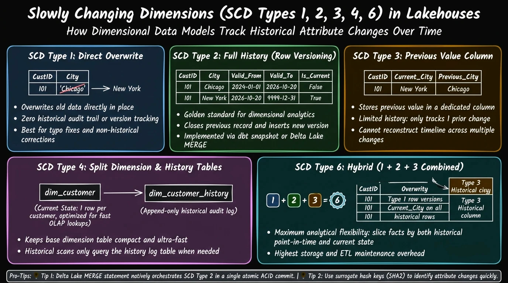
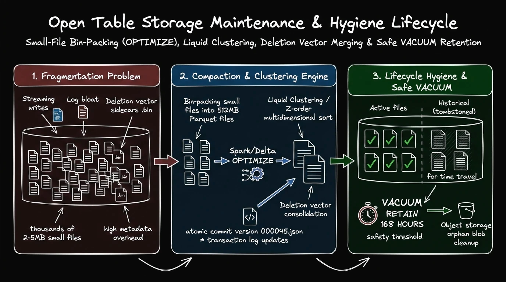
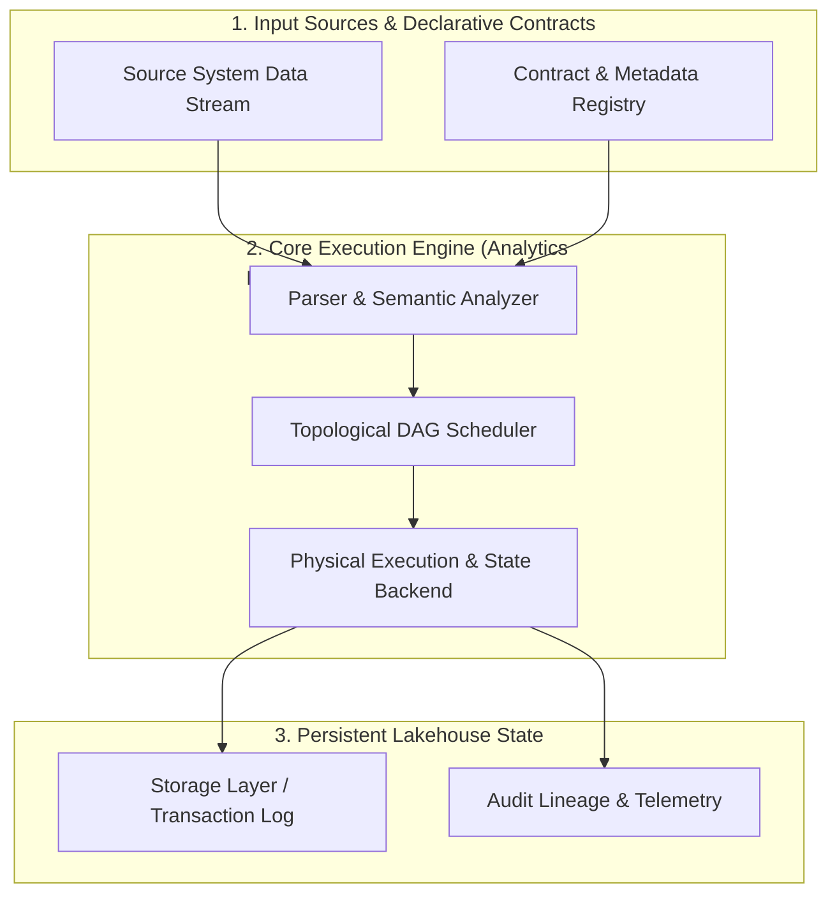
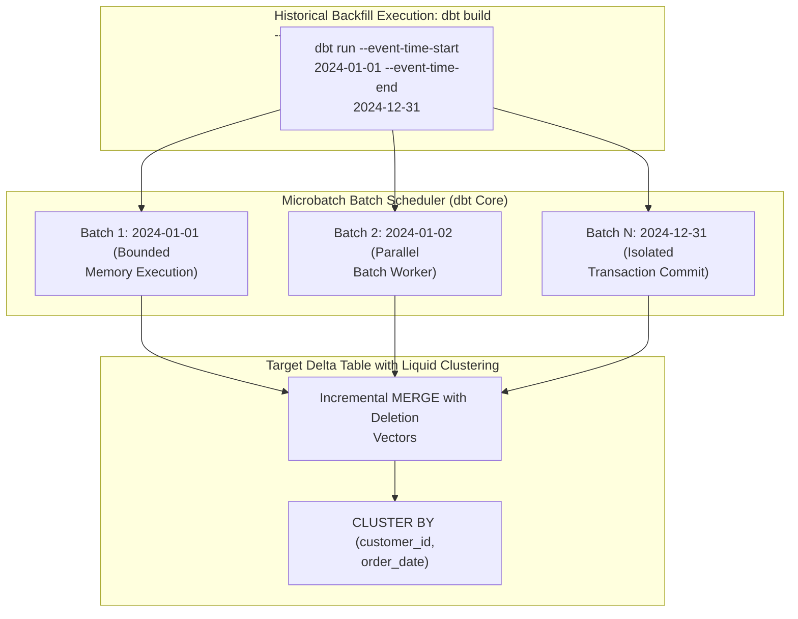

# 🏛️ Architecture: Incremental Materialization Mechanics


> *Architectural Blueprint: [Slowly Changing Dimensions (SCD Types 1, 2, 3, 4, 6) in Modern Lakehouses](../docs/whiteboard_diagrams/README.md#scd-types-lakehouse). View full multi-persona breakdown and engine mechanisms in the master index.*


> *Architectural Blueprint: [Open Table Maintenance Lifecycle: Bin-Packing, Liquid Clustering & Safe VACUUM](../docs/whiteboard_diagrams/README.md#table-maintenance-compaction-vacuum). View full multi-persona breakdown and engine mechanisms in the master index.*

> **Domain**: Analytics Engineering  
> **Target Audience**: Senior Engineers, Data Architects, Platform Leads  
> **Overview**: Under-the-hood comparison of merge, delete+insert, and insert_overwrite across cloud engines.

---

## 1. System Architecture & Component Interaction



---

## 2. Low-Level Mechanics & Operational Invariants

### Architectural Foundations:
In high-throughput enterprise deployments, `Incremental Materialization Mechanics` coordinates state synchronization, metadata tracking, and deterministic transformations.

1. **State Isolation**: Independent memory and storage boundaries prevent cross-task resource contention.
2. **Deterministic Execution**: All operations must be replayable from durable write-ahead logs or source checkpoints.
3. **Partition-Aware Scheduling**: Data routing enforces alignment across hash keys, avoiding shuffle penalties.

### Implementation Blueprint:
```python
# Production pipeline configuration pattern
pipeline_config = {
    "execution_mode": "distributed",
    "checkpoint_interval_seconds": 60,
    "max_concurrency_workers": 16,
    "state_backend": "off_heap_storage",
    "enable_adaptive_rebalancing": True
}
# Validate operational parameters
assert pipeline_config["checkpoint_interval_seconds"] > 0
```

---

## 3. Trade-offs & Production Hardening

| Architecture Dimension | Design Choice | Primary Trade-Off | Mitigating Control |
| :--- | :--- | :--- | :--- |
| **State Storage** | Off-Heap Managed Storage | High I/O throughput vs setup complexity | Local NVMe SSD scratch drives |
| **Consistency** | Exact-Once Semantics | Latency overhead vs zero data duplication | Two-Phase commit protocol |
| **Scaling** | Dynamic Auto-scaling | Rebalance pause time vs resource efficiency | Cooperative rebalance protocols |

---

## 4. Verification & Observability
- Monitor active lag metrics and consumer offsets every 10 seconds.
- Validate end-to-end processing SLA latency using distributed tracing.
- Maintain automated regression assertions across test environments.

---

## 4. Microbatch Incremental Materialization & Databricks Liquid Clustering

dbt 1.9+ introduces **Microbatch Incremental Materialization**, dividing massive backfill executions into discrete time-grained batches, paired with **Databricks Liquid Clustering (`cluster_by`)**.



### Production Implementation: Microbatch Model with Liquid Clustering in dbt
```sql
{{ config(
    materialized='incremental',
    incremental_strategy='microbatch',
    event_time='transaction_timestamp',
    batch_size='day',
    lookback=3,
    cluster_by=['customer_id', 'transaction_date'],
    tblproperties={
        'delta.enableDeletionVectors': 'true'
    }
) }}

-- Microbatch model executes discretely per day slice
SELECT
    transaction_id,
    customer_id,
    transaction_amount,
    transaction_timestamp,
    to_date(transaction_timestamp) AS transaction_date
FROM {{ ref('stg_ecommerce__transactions') }}
WHERE {{ model_batch_filter('transaction_timestamp') }}
```

### Key Microbatch Invariants:
- **Bounded Resource Consumption**: Eliminates warehouse out-of-memory (OOM) failures by bounding each transaction to a single discrete time grain.
- **Independent Task Retries**: If batch 14 fails due to network jitter, only that specific daily slice re-runs, rather than restarting the entire multi-month backfill.
