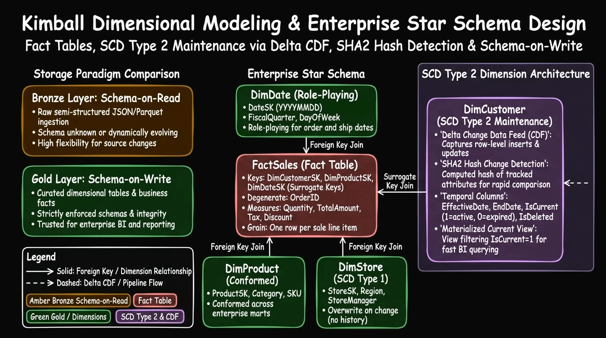
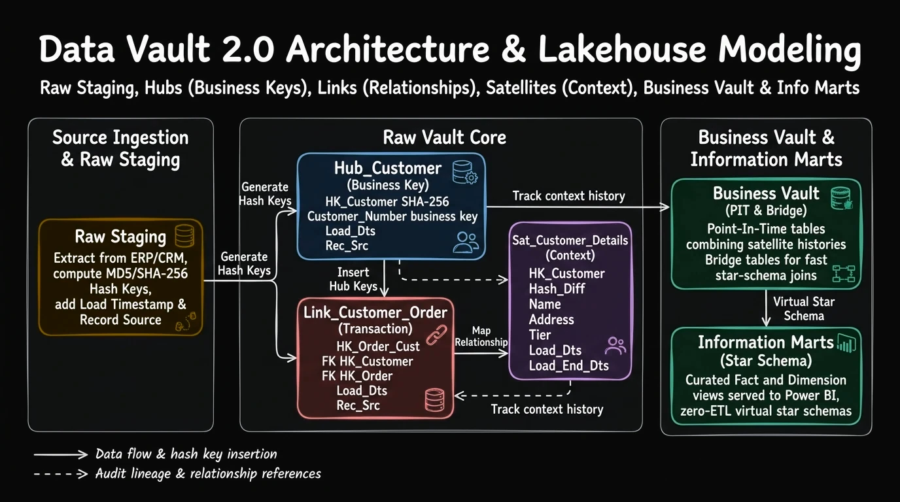
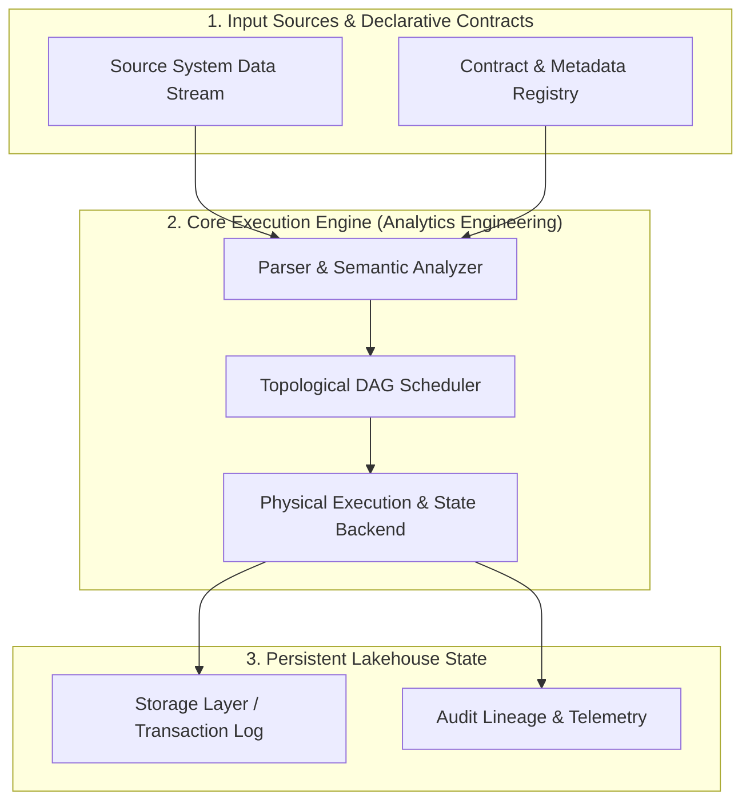
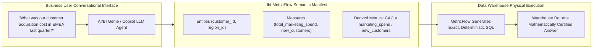

# 🏛️ Architecture: Semantic Layer & MetricFlow Architecture



> *Architectural Blueprint: [Kimball Dimensional Modeling & Enterprise Star Schema](../docs/whiteboard_diagrams/README.md#kimball-dimensional-star-schema). View full multi-persona breakdown and engine mechanisms in the master index.*



> *Architectural Blueprint: [Data Vault 2.0 Architecture & Lakehouse Modeling](../docs/whiteboard_diagrams/README.md#data-vault-enterprise-architecture). View full multi-persona breakdown and engine mechanisms in the master index.*


> **Domain**: Analytics Engineering  
> **Target Audience**: Senior Engineers, Data Architects, Platform Leads  
> **Overview**: Semantic models, dimensions, entities, and consistent query generation.

---

## 1. System Architecture & Component Interaction



---

## 2. Low-Level Mechanics & Operational Invariants

### Architectural Foundations:
In high-throughput enterprise deployments, `Semantic Layer & MetricFlow Architecture` coordinates state synchronization, metadata tracking, and deterministic transformations.

1. **State Isolation**: Independent memory and storage boundaries prevent cross-task resource contention.
2. **Deterministic Execution**: All operations must be replayable from durable write-ahead logs or source checkpoints.
3. **Partition-Aware Scheduling**: Data routing enforces alignment across hash keys, avoiding shuffle penalties.

### Implementation Blueprint:
```python
# Production pipeline configuration pattern
pipeline_config = {
    "execution_mode": "distributed",
    "checkpoint_interval_seconds": 60,
    "max_concurrency_workers": 16,
    "state_backend": "off_heap_storage",
    "enable_adaptive_rebalancing": True
}
# Validate operational parameters
assert pipeline_config["checkpoint_interval_seconds"] > 0
```

---

## 3. Trade-offs & Production Hardening

| Architecture Dimension | Design Choice | Primary Trade-Off | Mitigating Control |
| :--- | :--- | :--- | :--- |
| **State Storage** | Off-Heap Managed Storage | High I/O throughput vs setup complexity | Local NVMe SSD scratch drives |
| **Consistency** | Exact-Once Semantics | Latency overhead vs zero data duplication | Two-Phase commit protocol |
| **Scaling** | Dynamic Auto-scaling | Rebalance pause time vs resource efficiency | Cooperative rebalance protocols |

---

## 4. Verification & Observability
- Monitor active lag metrics and consumer offsets every 10 seconds.
- Validate end-to-end processing SLA latency using distributed tracing.
- Maintain automated regression assertions across test environments.

---

## 4. MetricFlow Semantic Layer & Conversational AI Integration (Genie & Copilot)

The dbt Semantic Layer (powered by MetricFlow) provides a declarative semantic contract that feeds directly into conversational AI engines (Databricks AI/BI Genie, Microsoft Copilot) to eliminate metric hallucinations.



### Production Configuration: MetricFlow Derived Metric Specification
```yaml
# MetricFlow semantic model definition with derived metrics
metrics:
  - name: customer_acquisition_cost
    label: "Customer Acquisition Cost (CAC)"
    type: derived
    type_params:
      expr: marketing_spend / NULLIF(new_customers_acquired, 0)
      metrics:
        - name: marketing_spend
        - name: new_customers_acquired
    description: "Certified enterprise CAC metric consumed by AI/BI Genie."
```

### Key Semantic Layer Invariants:
- **Zero Hallucinated Aggregations**: Generative AI queries the semantic layer API rather than authoring raw SQL against database tables, guaranteeing consistent formulas.
- **Role-Based Metric Governance**: Restricts sensitive executive metrics (e.g. profit margins) to authorized roles via semantic access policies.
