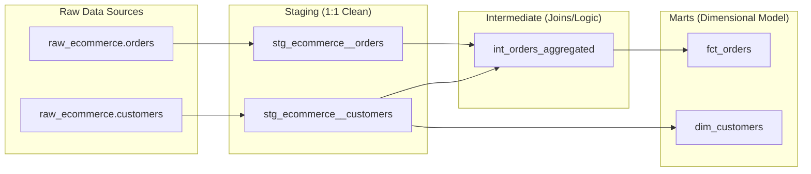

# Module 01: dbt Project Architecture, Directory Layout & Source Freshness

## 1. Enterprise Directory Anatomy
In production analytics engineering, a dbt project must maintain strict separation of concerns across layers:
- `models/staging/`: 1:1 mapping with raw source tables. Light cleaning, column renaming, datatype casting, and surrogate key generation. No business joins.
- `models/intermediate/`: Complex multi-table joins, window calculations, and entity consolidations. Reusable across downstream marts.
- `models/marts/`: Business-facing dimensional models (`dim_*`) and fact tables (`fct_*`). Star schema or denormalized reporting entities.



## 2. Source Declarations & Freshness SLA
Source definitions should live in `models/staging/<source_system>/_sources.yml`. Always configure source freshness tests:
```yaml
version: 2
sources:
  - name: ecommerce
    database: raw_lakehouse
    schema: ingestion_cdc
    loaded_at_field: _loaded_at_utc
    freshness:
      warn_after: {count: 6, period: hour}
      error_after: {count: 24, period: hour}
    tables:
      - name: orders
        description: "Raw immutable order records streamed from transactional Postgres DB."
        columns:
          - name: order_id
            description: "Transactional primary key."
            tests:
              - unique
              - not_null
```
