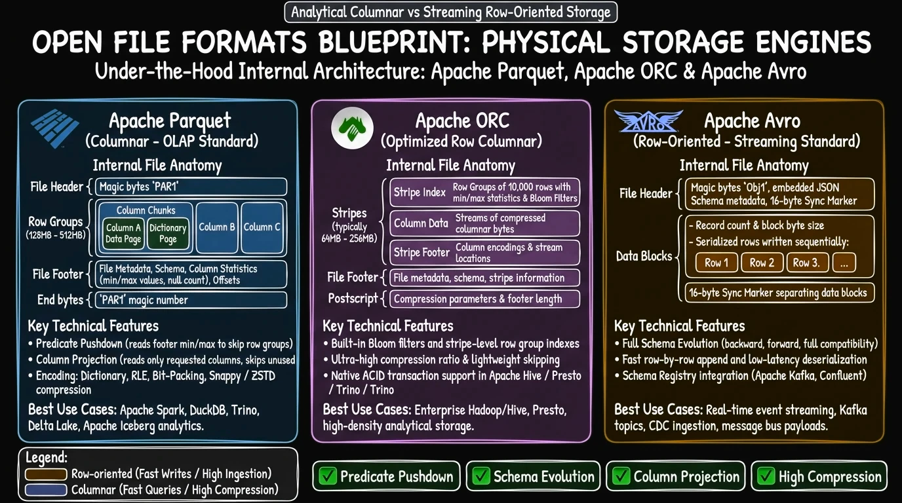

# Module 02: Materialization Strategies & Persistence

> *Architectural Blueprint: [Open File Formats Blueprint: Physical Storage Engines](../../docs/whiteboard_diagrams/README.md#open-file-formats-storage). View full multi-persona breakdown and engine mechanisms in the master index.*

## 1. Materialization Hierarchy & Tradeoffs
dbt provides five fundamental persistence strategies:
1. `view`: Zero compute storage overhead. Re-executes on every query. Ideal for light staging transforms.
2. `table`: Physical CTAS (Create Table As Select). High query performance; high build cost.
3. `incremental`: Updates only new or mutated rows since last run. Essential for tables $> 10\text{M}$ rows.
4. `ephemeral`: Inlined CTE. Does not create database objects. Reduces DDL clutter.
5. `materialized_view`: Database-native automatically refreshed view (Snowflake Dynamic Tables, BigQuery MVs, Databricks Streaming Tables).

| Materialization | Write Cost | Read Latency | Storage Overhead | Best Fit |
| :--- | :--- | :--- | :--- | :--- |
| `view` | Lowest (Metadata) | High (Full Scan) | None | Staging models, lightweight abstractions |
| `table` | High (Full Rebuild) | Low (Precomputed) | High | Small-to-medium marts ($< 10\text{M}$ rows) |
| `incremental` | Low-to-Medium | Low | High | Large transactional fact tables |
| `materialized_view` | Managed by Engine | Lowest | Managed | Low-latency dashboard feeds |
