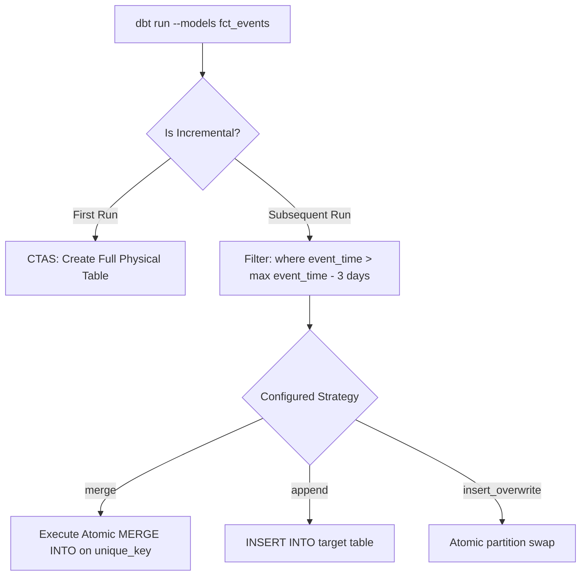

# Module 03: Incremental Strategies, Lookback Windows & Microbatch


> *Architectural Blueprint: [Open Table Maintenance Lifecycle: Bin-Packing, Liquid Clustering & Safe VACUUM](../../docs/whiteboard_diagrams/README.md#table-maintenance-compaction-vacuum). View full multi-persona breakdown and engine mechanisms in the master index.*


## 1. Incremental Mechanics & Strategy Matrix
Incremental execution isolates transformed deltas:
- `merge`: Performs atomic `MERGE INTO` matching on `unique_key`. Handles inserts and in-place updates.
- `delete+insert`: Emits atomic `DELETE WHERE unique_key IN (...)` followed by `INSERT`. Required for databases lacking native MERGE.
- `append`: Pure append-only. Ideal for immutable telemetry, audit logs, and raw clickstreams.
- `insert_overwrite`: Replaces whole partitions dynamically. Zero row-level lock contention.
- `microbatch` (dbt 1.9+): Partitions incremental runs into bounded micro-batches, preventing memory exhaustion on historical backfills.



---

## 2. Production dbt 1.9+ Microbatch Strategy Model

The `microbatch` strategy automatically divides execution into deterministic, date-partitioned micro-batches. This eliminates warehouse memory spills and lock contention during large historical backfills:

```sql
-- models/marts/fct_telemetry_microbatch.sql
{{
    config(
        materialized='incremental',
        incremental_strategy='microbatch',
        unique_key=['device_id', 'event_timestamp'],
        event_time='event_timestamp',
        batch_size='day',
        lookback=3,
        on_schema_change='append_new_columns',
        cluster_by=['device_id', 'event_timestamp']
    )
}}

SELECT
    device_id,
    event_timestamp,
    metric_name,
    metric_value,
    firmware_version,
    ingested_at
FROM {{ ref('stg_device_telemetry') }}


    -- Filter bounded to microbatch execution window
    WHERE event_timestamp >= DB_MICROBATCH_START() 
      AND event_timestamp < DB_MICROBATCH_END()

```

---

## 3. Production Multi-Column MERGE Model with Schema Contracts

```sql
-- models/marts/fct_customer_orders.sql
{{
    config(
        materialized='incremental',
        incremental_strategy='merge',
        unique_key='order_id',
        merge_update_columns=['order_status', 'updated_at', 'total_amount_usd'],
        on_schema_change='append_new_columns'
    )
}}

SELECT
    order_id,
    customer_id,
    order_status,
    total_amount_usd,
    order_timestamp,
    updated_at
FROM {{ ref('stg_orders') }}


    -- Lookback window handles late-arriving CDC records
    WHERE updated_at >= (SELECT MAX(updated_at) - INTERVAL '3 days' FROM {{ this }})

```

```yaml
# models/marts/fct_customer_orders.yml
version: 2
models:
  - name: fct_customer_orders
    description: "Production orders fact table with contract enforcement and SCD-aware lookback window."
    config:
      contract:
        enforced: true
    columns:
      - name: order_id
        data_type: string
        constraints:
          - type: not_null
          - type: primary_key
      - name: customer_id
        data_type: string
        constraints:
          - type: not_null
      - name: order_status
        data_type: string
      - name: total_amount_usd
        data_type: numeric(18, 4)
      - name: order_timestamp
        data_type: timestamp
      - name: updated_at
        data_type: timestamp
```
