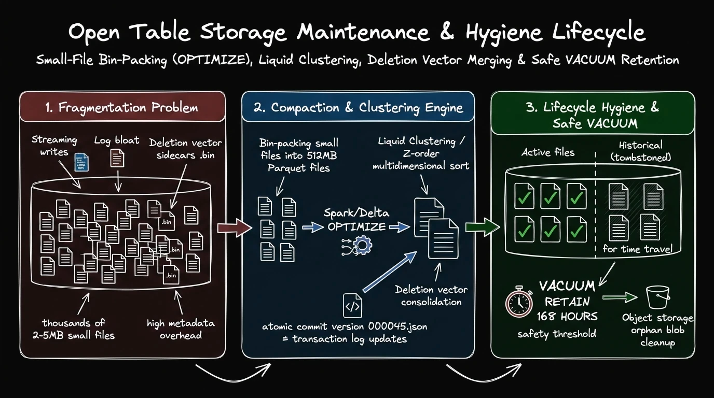
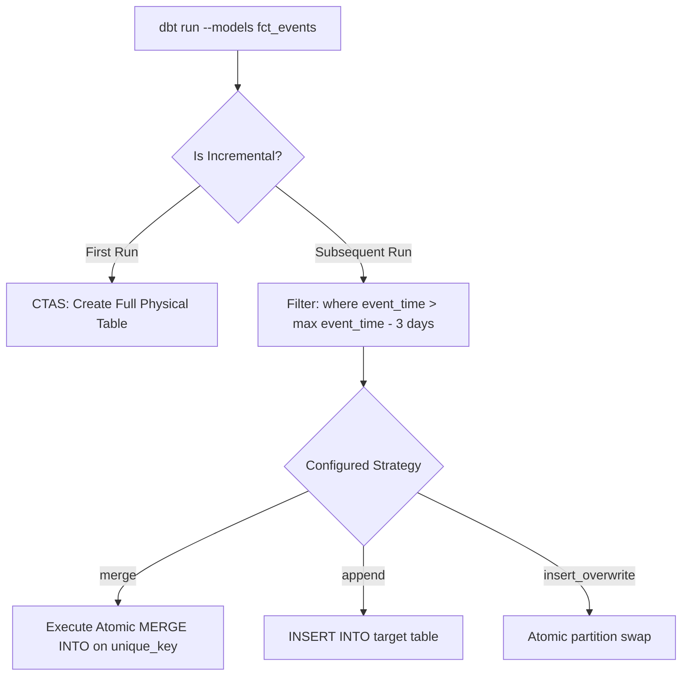

# Module 03: Incremental Strategies, Lookback Windows & Microbatch

> *Architectural Blueprint: [Open Table Maintenance Lifecycle: Bin-Packing, Liquid Clustering & Safe VACUUM](../../docs/whiteboard_diagrams/README.md#table-maintenance-compaction-vacuum). View full multi-persona breakdown and engine mechanisms in the master index.*

## 1. Incremental Mechanics & Strategy Matrix
Incremental execution isolates transformed deltas:
- `merge`: Performs atomic `MERGE INTO` matching on `unique_key`. Handles inserts and in-place updates.
- `delete+insert`: Emits atomic `DELETE WHERE unique_key IN (...)` followed by `INSERT`. Required for databases lacking native MERGE.
- `append`: Pure append-only. Ideal for immutable telemetry, audit logs, and raw clickstreams.
- `insert_overwrite`: Replaces whole partitions dynamically. Zero row-level lock contention.
- `microbatch` (dbt 1.9+): Partitions incremental runs into bounded micro-batches, preventing memory exhaustion on historical backfills.

