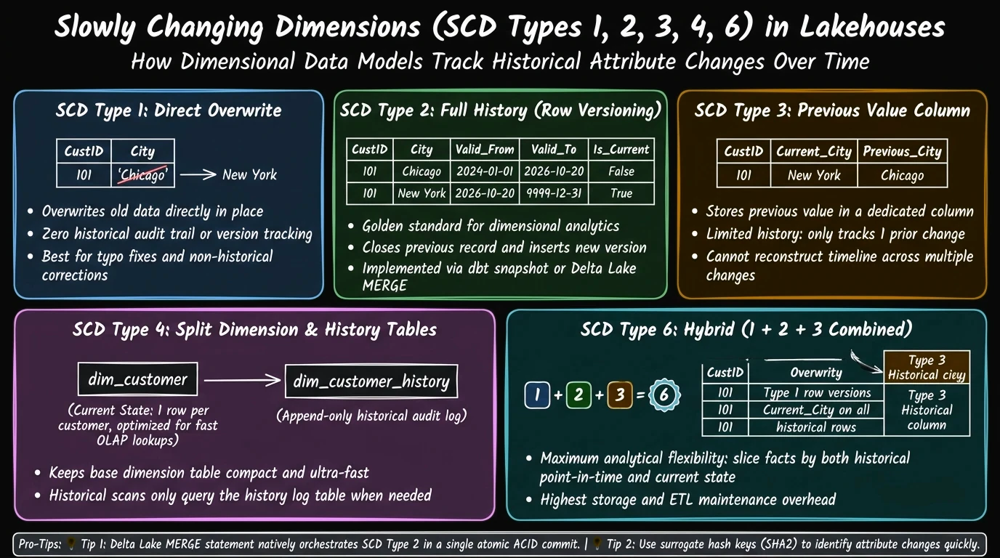

# Module 05: Snapshots & Slowly Changing Dimensions Type 2 (SCD2)

> *Architectural Blueprint: [Slowly Changing Dimensions (SCD Types 1, 2, 3, 4, 6) in Modern Lakehouses](../../docs/whiteboard_diagrams/README.md#scd-types-lakehouse). View full multi-persona breakdown and engine mechanisms in the master index.*

## 1. Snapshot Internals
dbt snapshots automatically inject and manage four critical audit columns:
- `dbt_scd_id`: Unique surrogate hash of natural key + valid_from timestamp.
- `dbt_updated_at`: Source update timestamp.
- `dbt_valid_from`: Start timestamp for this specific attribute state.
- `dbt_valid_to`: End timestamp for this state (`NULL` represents the current active record).

## 2. Timestamp vs Check Strategies
- `timestamp`: Uses a reliable `updated_at` column from transactional source systems. Highly performant.
- `check`: Computes a hash across monitored columns when source systems lack reliable update timestamps.
