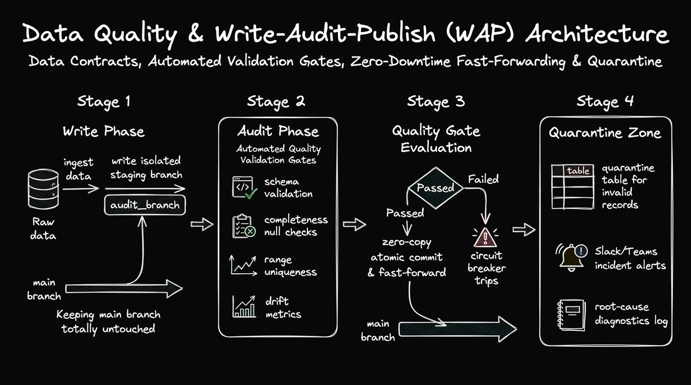

> 🧭 **Modern Data Engineering Ecosystem Navigation**
> - 📘 **Architecture & Concept:** [System Design — Zero-Trust Security & Governance](https://github.com/santoshjammi29/data-system-design-handbook/tree/main/modules/08_zero_trust_security_and_governance)
> - 💻 **Hands-On Recipe:** [dbt Handbook — Module 06: Data Contracts & Model Constraints](https://github.com/santoshjammi29/dbt-handbook/tree/main/modules/06_data_contracts_and_model_constraints) *(You are here)*
> - 🔬 **Empirical Lab:** [Banking Risk Lakehouse — IFRS 9 ECL Pipeline](https://github.com/santoshjammi29/enterprise-banking-risk-alm-lakehouse/blob/main/src/credit_risk_ifrs9/ecl_engine.py)
> - 🚨 **Incident Runbook:** [dbt-handbook Runbook: Data Contract Violations](https://github.com/santoshjammi29/dbt-handbook/tree/main/runbooks)
> - 🎯 **Interview Defense:** [Interview Handbook — Pillar 07: dbt Data Build Tool](https://github.com/santoshjammi29/data-engineering-interview-handbook/blob/main/pillars/07_dbt_data_build_tool.md)
> - 🌐 **Interactive Web Practice:** [Practice on moderndataengineer.uk](https://moderndataengineer.uk/practice/dbt?topic=data-contracts)

# Module 06: Data Contracts & Model Constraints



> *Architectural Blueprint: [Data Quality Observability & Write-Audit-Publish (WAP) Circuit Breaker Flow](../../docs/whiteboard_diagrams/README.md#data-quality-wap-quarantine). View full multi-persona breakdown and engine mechanisms in the master index.*


## 1. Model Contracts in dbt 1.5+
Data contracts ensure that models adhere strictly to predefined schemas before building in production. If a column name changes, datatype changes, or a constraint is violated, the build fails immediately.

```yaml
version: 2
models:
  - name: fct_orders_contracted
    config:
      contract:
        enforced: true
    columns:
      - name: order_id
        data_type: string
        constraints:
          - type: not_null
          - type: primary_key
      - name: customer_id
        data_type: string
        constraints:
          - type: not_null
      - name: order_amount_usd
        data_type: numeric(18,2)
        constraints:
          - type: check
            expression: "order_amount_usd >= 0"
```
