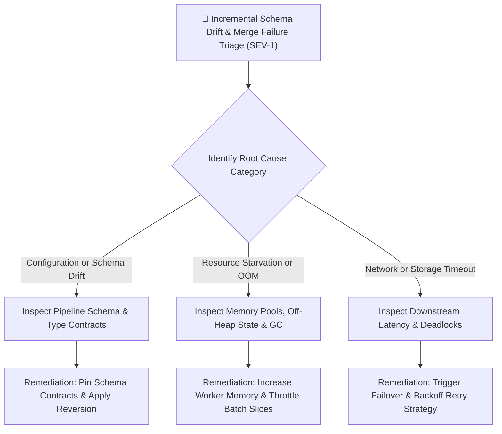

# 🚨 Production Runbook: Incremental Schema Drift & Merge Failure Triage

> **Severity**: `SEV-1`  
> **Domain**: Analytics Engineering  
> **Key Focus**: Triage unannounced upstream column additions, type mismatches, and merge conflicts.

---

## 1. Emergency Decision Tree



---

## 2. Immediate Diagnostic Procedures (First 5 Minutes)

### Step 1: Query Error Signatures and Pipeline Metrics
Run the following inspection commands to isolate the fault:
```bash
# Check pipeline task status and recent error traces
echo "Inspecting error status for pipeline..."
grep -E "ERROR|CRITICAL|Exception|Timeout" /var/log/pipeline.log | tail -n 25
```

### Step 2: Inspect Worker and State Health
Check memory, disk saturation, and open file descriptors:
```bash
# Verify worker container resource utilization
ps aux --sort=-%mem | head -n 10
```

---

## 3. Root Cause Analysis & Detailed Remediation

### Primary Root Cause
In production systems, this incident typically originates from sudden traffic surges, upstream breaking schema mutations, or resource limits being breached without backpressure.

### Remediation & Recovery Strategy:
1. **Apply Emergency Throttle**: Restrict incoming batch size or pause non-critical consumers.
2. **Apply Hotfix Configuration**:
   ```python
   # Emergency throttle configuration
   throttle_rate_per_sec = 5000
   retry_backoff_multiplier = 2.0
   max_retry_limit = 5
   ```
3. **Execute Recovery Step**: Re-run the validation test suite and verify consumer convergence.

---

## 4. Verification & Prevention Checklist

- [ ] Pipeline metrics return to baseline with 0 active error alerts.
- [ ] Processing latency conforms to standard production SLAs.
- [ ] Postmortem root cause documented and shared with architecture leads.


---

## 5. Mosaic AI SQL Functions Output Drift & dbt MERGE Triage

### 5.1 Incident Symptoms & Root Cause
- **Symptoms**: Incremental dbt model run fails with `DELTA_FAILED_TO_MERGE_FIELDS` or schema drift assertions fail on models using `ai_extract()` or `ai_query()`.
- **Root Cause**: The underlying foundation model returned an unquoted JSON payload or new JSON keys that violated the expected dbt schema during the incremental MERGE step.

### 5.2 Remediation & Safe Schema Parsing
1. **Wrap AI Output in Schema-Guarded JSON Parsing**:
```sql
-- Safe extraction with fallback to prevent schema merge failures
SELECT 
    survey_id,
    coalesce(
        from_json(
            ai_extract(feedback_text, ARRAY('sentiment', 'urgency')),
            'STRUCT<sentiment: STRING, urgency: STRING>'
        ),
        named_struct('sentiment', 'unknown', 'urgency', 'normal')
    ) AS extracted_payload
FROM staging_surveys;
```

2. **Add dbt Generic Tests**: Enforce not-null and accepted-value validations in `schema.yml` to quarantine anomalous LLM responses before landing in production Gold marts.
