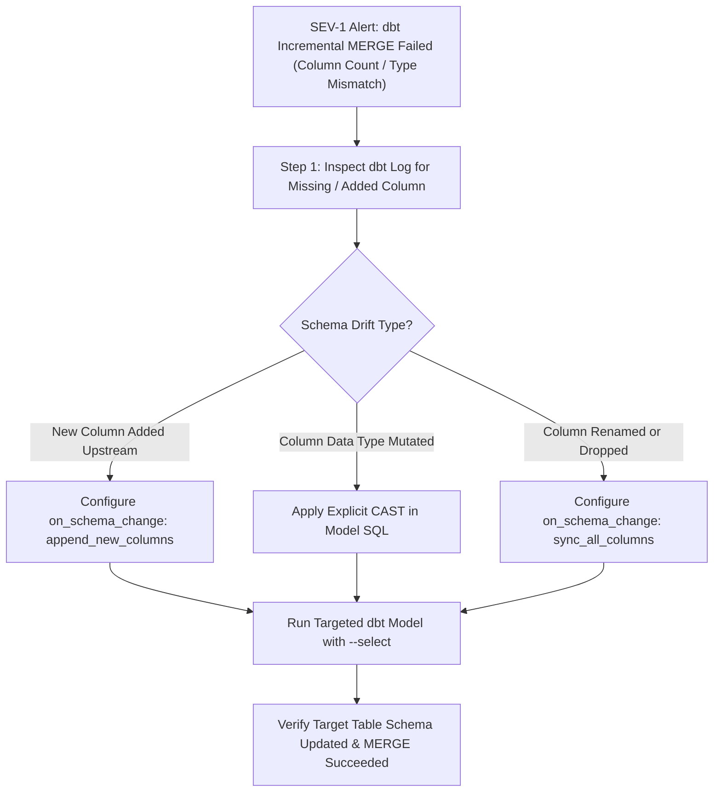

# 🚨 Production Runbook 01: Incremental Schema Drift & MERGE Failure Triage

> **Incident Severity**: `SEV-1`  
> **Domain**: Analytics Engineering & dbt Core / Cloud  
> **Target Systems**: Snowflake, Databricks, BigQuery, dbt Core/Cloud  
> **Objective**: Resolve upstream schema drift breaking incremental `MERGE` models without triggering expensive full refreshes.

---

## 1. Emergency Decision Tree



---

## 2. Immediate Diagnostic Procedures (First 5 Minutes)

### Step 1: Inspect dbt Failure Log
```bash
# Locate exact failing SQL and compilation target
grep -E "Database Error in model|Number of columns does not match|schema drift" target/dbt.log | tail -n 25
```

### Step 2: Compare Staging View vs Target Incremental Table Schema
```sql
-- Snowflake / Databricks: Check column differences
SELECT column_name, data_type 
FROM information_schema.columns 
WHERE table_name = 'stg_orders'
EXCEPT
SELECT column_name, data_type 
FROM information_schema.columns 
WHERE table_name = 'fct_orders';
```

---

## 3. Root Cause Analysis & Production Remediation

### Primary Root Cause
By default, dbt incremental models generate a `MERGE INTO target USING source` statement expecting identical schema columns. When an upstream migration adds a column without `on_schema_change` enabled, the SQL engine rejects the MERGE.

### Production Remediation: Model Contract & Incremental Strategy

```sql
-- models/marts/fct_orders.sql
{{
    config(
        materialized='incremental',
        incremental_strategy='merge',
        unique_key='order_id',
        on_schema_change='append_new_columns',
        merge_update_columns=['order_status', 'updated_at', 'order_total_usd']
    )
}}

SELECT
    order_id,
    customer_id,
    order_status,
    order_total_usd,
    created_at,
    updated_at
FROM {{ ref('stg_orders') }}


    -- Bounded incremental lookback window protects against out-of-order writes
    WHERE updated_at >= (SELECT MAX(updated_at) - INTERVAL '3 days' FROM {{ this }})

```

#### Enforce Model Contracts in YAML
```yaml
# models/marts/schema.yml
version: 2
models:
  - name: fct_orders
    config:
      contract:
        enforced: true
    columns:
      - name: order_id
        data_type: string
        constraints:
          - type: not_null
          - type: primary_key
      - name: customer_id
        data_type: string
      - name: order_status
        data_type: string
      - name: order_total_usd
        data_type: numeric(18, 4)
      - name: updated_at
        data_type: timestamp
```

---

## 4. Verification & Prevention
- [ ] Run `dbt run --select fct_orders` and confirm successful incremental MERGE.
- [ ] Verify `dbt test --select fct_orders` passes all primary key and contract assertions.
- [ ] Ensure all incremental models specify `on_schema_change: 'append_new_columns'`.
