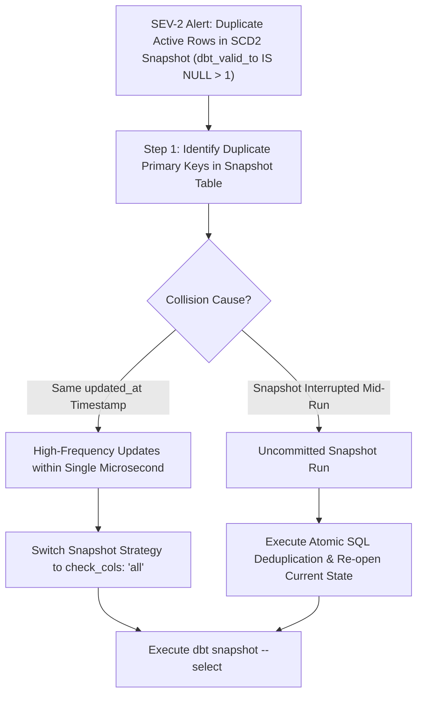

# 🚨 Production Runbook 02: dbt Snapshot SCD2 Timestamp Collision Triage

> **Incident Severity**: `SEV-2`  
> **Domain**: Analytics Engineering & dbt Snapshots  
> **Target Systems**: Snowflake, Databricks, PostgreSQL, dbt Core/Cloud  
> **Objective**: Detect and repair overlapping `dbt_valid_to` records and duplicate active dimension rows.

---

## 1. Emergency Decision Tree



---

## 2. Immediate Diagnostic Procedures (First 5 Minutes)

### Step 1: Detect Duplicate Active Rows per Entity
```sql
SELECT
    customer_id,
    COUNT(*) AS active_record_count
FROM snapshots.snap_customers
WHERE dbt_valid_to IS NULL
GROUP BY customer_id
HAVING COUNT(*) > 1;
```

### Step 2: Detect Overlapping Valid Time Ranges
```sql
SELECT
    a.customer_id,
    a.dbt_valid_from AS a_from,
    a.dbt_valid_to AS a_to,
    b.dbt_valid_from AS b_from,
    b.dbt_valid_to AS b_to
FROM snapshots.snap_customers a
JOIN snapshots.snap_customers b
  ON a.customer_id = b.customer_id
 AND a.dbt_scd_id != b.dbt_scd_id
 AND a.dbt_valid_from < COALESCE(b.dbt_valid_to, '9999-12-31')
 AND COALESCE(a.dbt_valid_to, '9999-12-31') > b.dbt_valid_from;
```

---

## 3. Root Cause Analysis & Production Remediation

### Primary Root Cause
When an upstream transactional system executes multiple mutations within the granularity of the timestamp column (e.g. within the same second), dbt's `timestamp` snapshot strategy generates identical `dbt_valid_from` timestamps, causing multiple records to remain active (`dbt_valid_to IS NULL`).

### Production Remediation: Switch to Check Strategy & SQL Repair

#### Phase 1: Robust dbt Snapshot Definition
```sql
-- snapshots/snap_customers.sql


{{
    config(
      target_schema='snapshots',
      unique_key='customer_id',
      strategy='check',
      check_cols=['email', 'tier', 'credit_limit', 'billing_address'],
      invalidate_hard_deletes=True
    )
}}

SELECT
    customer_id,
    email,
    tier,
    credit_limit,
    billing_address,
    updated_at
FROM {{ source('crm', 'raw_customers') }}


```

#### Phase 2: Atomic Cleanup of Corrupted Active Records
```sql
-- Close earlier duplicate active records
UPDATE snapshots.snap_customers
SET dbt_valid_to = updated_at
WHERE dbt_scd_id IN (
    SELECT dbt_scd_id
    FROM (
        SELECT
            dbt_scd_id,
            ROW_NUMBER() OVER (PARTITION BY customer_id ORDER BY updated_at DESC, dbt_updated_at DESC) AS rn
        FROM snapshots.snap_customers
        WHERE dbt_valid_to IS NULL
    ) sub
    WHERE sub.rn > 1
);
```

---

## 4. Verification & Prevention
- [ ] Verify query for duplicate active rows returns zero records.
- [ ] Add `dbt-expectations` test: `expect_compound_columns_to_be_unique` on `(customer_id, dbt_valid_to)`.
