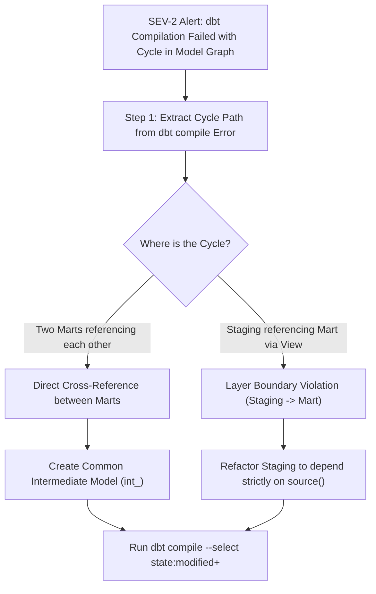

# 🚨 Production Runbook 03: Circular Dependency & dbt DAG Deadlock Triage

> **Incident Severity**: `SEV-2`  
> **Domain**: Analytics Engineering & Lineage Graphs  
> **Target Systems**: dbt Core / Cloud Compilation Engine  
> **Objective**: Identify cycle paths in dbt ref graphs and refactor intermediate models to restore compilation.

---

## 1. Emergency Decision Tree



---

## 2. Immediate Diagnostic Procedures (First 5 Minutes)

### Step 1: Locate Cycle Path from Compilation Output
```bash
# Compile project and isolate cycle trace
dbt compile 2>&1 | grep -A 10 "Found a cycle in the model graph"
```

### Step 2: Trace Dependency Lineage
```bash
# Print upstream and downstream lineage of offending model
dbt ls --select "+fct_orders+"
```

---

## 3. Root Cause Analysis & Production Remediation

### Primary Root Cause
Cycles occur when analytical models violate strict layered information architecture (e.g. Mart A refs Mart B, while Mart B refs a CTE derived from Mart A).

### Production Remediation: Decouple Shared Logic into Intermediate Layer

```
❌ Anti-Pattern:
fct_orders --> dim_customers --> fct_orders (Cycle!)

✅ Correct Architecture:
stg_orders ----> int_customer_order_metrics ----> dim_customers
stg_customers ->                                 ----> fct_orders
```

#### Intermediate Model Refactor:
```sql
-- models/intermediate/int_customer_order_metrics.sql
SELECT
    customer_id,
    COUNT(order_id) AS lifetime_order_count,
    SUM(order_total_usd) AS lifetime_revenue_usd,
    MAX(created_at) AS last_order_timestamp
FROM {{ ref('stg_orders') }}
GROUP BY customer_id
```

---

## 4. Verification & Prevention
- [ ] Run `dbt compile` and verify clean DAG generation without warnings.
- [ ] Install CI linter rule enforcing unidirectional layering: `sources -> stg_ -> int_ -> fct_/dim_`.
