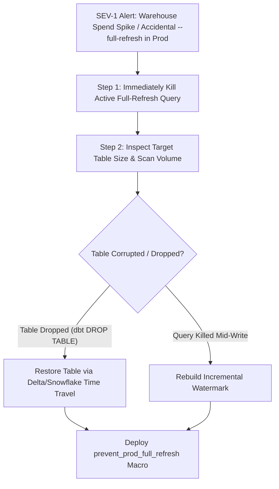

# 🚨 Production Runbook 04: Warehouse Credit Exhaustion from Accidental Full Refresh

> **Incident Severity**: `SEV-1`  
> **Domain**: FinOps & Data Warehouse Cost Governance  
> **Target Systems**: Snowflake, Databricks SQL, BigQuery, dbt Cloud  
> **Objective**: Terminate runaway multi-terabyte full refresh queries, isolate cost impact, and install CI/CD guardrails.

---

## 1. Emergency Decision Tree



---

## 2. Immediate Diagnostic Procedures (First 5 Minutes)

### Step 1: Terminate Runaway Query Immediately
```sql
-- Snowflake: Find and abort full refresh query
SELECT query_id, user_name, warehouse_name, total_elapsed_time / 1000 AS seconds_running
FROM table(information_schema.query_history_by_warehouse('PROD_TRANSFORM_WH'))
WHERE execution_status = 'RUNNING' AND query_text ILIKE '%drop table%'
ORDER BY start_time DESC;

-- Kill query
SELECT SYSTEM$CANCEL_QUERY('<QUERY_ID>');
```

---

## 3. Root Cause Analysis & Production Remediation

### Primary Root Cause
A developer ran `dbt run --full-refresh` targeting production instead of staging, causing dbt to execute `DROP TABLE` and initiate a multi-billion-row full rescan on multi-cluster warehouses.

### Production Remediation: Full Refresh Guardrail Macro

```sql
-- macros/prevent_prod_full_refresh.sql

    
        
        
            {{ exceptions.raise_compiler_error(
                "❌ BLOCKED: dbt --full-refresh is disabled in production! " ~
                "To force a full refresh, you must explicitly pass: --vars '{"allow_full_refresh": true}'"
            ) }}
        
    

```

#### Hook Guardrail into dbt_project.yml
```yaml
# dbt_project.yml
on-run-start:
  - "{{ prevent_prod_full_refresh() }}"
```

---

## 4. Verification & Prevention
- [ ] Test `dbt run --full-refresh --target prod` locally and confirm compilation error blocks execution.
- [ ] Verify `dbt run --full-refresh --target prod --vars '{"allow_full_refresh": true}'` permits authorized bypass.
- [ ] Configure auto-suspension timeout on Snowflake warehouse to $\le 60	ext{ seconds}$.
