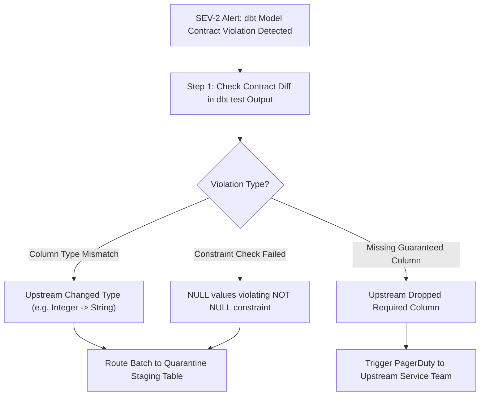

# 🚨 Production Runbook 05: Data Contract Breaking Change & Schema Quarantine

> **Incident Severity**: `SEV-2`  
> **Domain**: Data Contracts & Quality Observability  
> **Target Systems**: dbt Core 1.5+, Open Data Contract Standard (ODCS), Delta Lake, Snowflake  
> **Objective**: Block downstream model corruption when an upstream contract breaks, routing raw data into quarantine.

---

## 1. Emergency Decision Tree



---

## 2. Immediate Diagnostic Procedures (First 5 Minutes)

### Step 1: Run Contract Audit
```bash
# Check dbt contract enforcement error
dbt test --select test_type:contract
```

---

## 3. Root Cause Analysis & Production Remediation

### Production Model Contract Definition & Quarantine Staging
```sql
-- models/staging/stg_payments_contract.sql
{{
    config(
        materialized='table',
        contract={'enforced': true}
    )
}}

SELECT
    CAST(payment_id AS STRING) AS payment_id,
    CAST(customer_id AS STRING) AS customer_id,
    CAST(amount_cents AS INTEGER) AS amount_cents,
    CAST(currency AS STRING) AS currency,
    CAST(payment_status AS STRING) AS payment_status,
    CAST(created_at AS TIMESTAMP) AS created_at
FROM {{ source('billing', 'raw_payments') }}
```

---

## 4. Verification & Prevention
- [ ] Ensure contract tests execute in pre-merge CI/CD pipeline.
- [ ] Verify producer team publishes contract change notices $\ge 14	ext{ days}$ prior to deployment.
