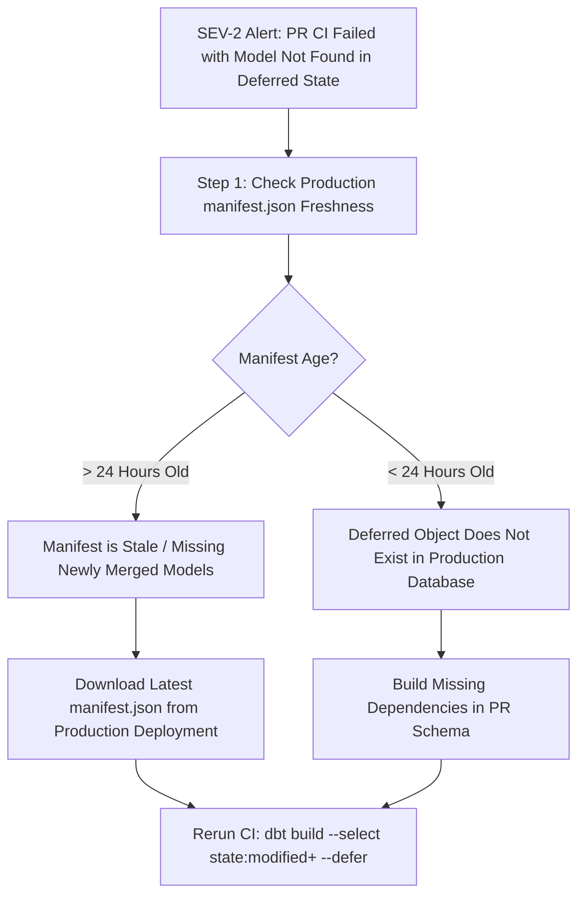

# 🚨 Production Runbook 06: Slim CI State Deferral & Missing Object Triage

> **Incident Severity**: `SEV-2`  
> **Domain**: DataOps CI/CD & dbt Cloud / GitHub Actions  
> **Target Systems**: dbt Core, GitHub Actions, AWS S3 / Azure Blob Storage  
> **Objective**: Resolve `dbt --defer --state` failures caused by stale production `manifest.json` artifacts.

---

## 1. Emergency Decision Tree



---

## 2. Immediate Diagnostic Procedures (First 5 Minutes)

### Step 1: Check CI Deferral Error Signature
```bash
# Look for object resolution error in CI log
grep -E "Database error: object does not exist|dbt was unable to find an upstream model" ci_run.log
```

---

## 3. Root Cause Analysis & Production Remediation

### Production GitHub Actions Workflow for Slim CI
```yaml
# .github/workflows/dbt_slim_ci.yml
name: dbt Slim CI
on: [pull_request]

jobs:
  slim_ci:
    runs-on: ubuntu-latest
    steps:
      - uses: actions/checkout@v4
      - name: Set up Python
        uses: actions/setup-python@v5
        with:
          python-version: '3.11'

      - name: Install dbt
        run: pip install dbt-snowflake

      - name: Download Production manifest.json
        run: |
          aws s3 cp s3://company-dbt-artifacts/prod/manifest.json ./prod_manifest/manifest.json

      - name: Run Modified Models with Deferral
        run: |
          dbt build             --select state:modified+             --state ./prod_manifest             --defer             --target ci             --threads 4
```

---

## 4. Verification & Prevention
- [ ] Confirm PR runs compile successfully against production state without rebuilding unchanged models.
- [ ] Verify production merge workflow automatically publishes updated `manifest.json` to S3 after every run.
